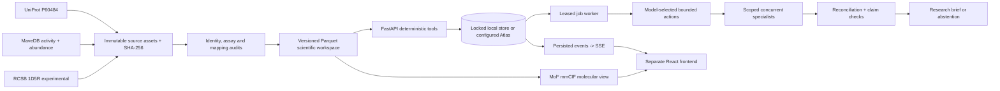

# Bramha Atlas — End-to-End Project Report

> **Molecular overview and provider update:** See [Home composition, provenance and checks](variant-atlas/docs/MOLECULAR_OVERVIEW.md). A supplied Google key is now configured; catalogue access lists Argon, but the first generation check was rate limited and a bounded recheck timed out, so generation remains unverified.

> **Workflow update, 24 October 2026:** The UI and metadata layer have since been restructured around projects and a shared source catalogue. See [the current route map, migration and verification](variant-atlas/docs/RESEARCH_WORKFLOW_ROUTES.md). Older navigation descriptions and test counts below are historical context. Scientific acceptance and external-provider caveats still apply.

**Repository:** `Encode_2026`
**Application:** `variant-atlas/` (Bramha Atlas)
**Report date:** 24 October 2026
**Status:** working local prototype on audited public data, with several acceptance gates explicitly **not** passed

---

## 1. At a glance

| Item | Value |
|---|---|
| Product | Evidence-first research workspace for protein-variant investigation (human PTEN) |
| Agent role specifications | **14** across two engines (7 + 7) |
| Agents live in a typical run | **3–4** (1 coordinator + 2–3 scoped specialists) |
| Executable tools in the catalog | **30** typed capabilities |
| Backend | Python 3.11, FastAPI, async leased worker, atomic local JSON store (optional MongoDB Atlas) |
| Frontend | React + TypeScript + Vite, Mol\* molecular viewer, React Three Fiber (synthetic scene), SSE streaming |
| Code size | ~8,700 lines across `backend/app` + `frontend/src` |
| Backend tests | 65 test functions (latest recorded full run: **67 passed**) |
| Browser tests | 25 Playwright scenarios (latest recorded full run: **24 scenarios, 23 passed + targeted reruns green**) |
| Live model used in development | OpenRouter `x-ai/grok-4.3` |
| Google Argon / Gemini Live | adapters implemented, **credentials absent, unverified** |
| Atlas Search + Vector Search | pipeline implemented, **credentials absent, unverified** |
| Independent researcher review | **pending** |

The honest one-line summary: the orchestration, data audit, verification and UI layers are real and tested; the *scientific acceptance* of an autonomous end-to-end run, and the Google/Atlas/voice tracks, are not yet proven.

---

## 2. What the project is doing

### 2.1 The problem

A researcher asking "which PTEN substitutions deserve a follow-up experiment, and why?" has to join three incompatible things by hand:

1. a canonical protein sequence (UniProt P60484),
2. two deep mutational scanning datasets measured on **different scales** (a yeast-growth activity proxy and a VAMP-seq abundance score),
3. an experimental crystal structure (RCSB **1D5R**) that is a truncated, engineered construct with unresolved residues.

Naively merging them produces confident nonsense: fabricated coordinates for unmapped residues, cross-assay comparisons on incomparable scales, and model prose that invents numbers.

### 2.2 The approach

Bramha Atlas inverts the usual LLM product shape. **The model decides what work to do; deterministic code decides what is true.**

- The model plans, delegates, chooses tools, revises hypotheses and finalizes or abstains.
- Every number, mapping, distance and eligibility decision comes from a typed Python tool against pinned data.
- Every model claim is mechanically checked against saved artifacts before it can be saved — and an unverifiable claim forces a revision or an abstention, not a softer sentence.
- Every step is persisted as a durable event, so a run is inspectable and replayable rather than a chat transcript.

### 2.3 What it explicitly does **not** do

No mutant folding or predicted structure. No clinical or pathogenicity claims. No cross-assay causal mechanism. No treatment or cure claim. No simulated progress bars standing in for model work. No silent fixture fallback when a configured provider fails.

---

## 3. Agent roster — how many agents are working

There are **two independent agent engines** in the repository. Both use the same durable action loop, budgets, event log and verification boundary.

### 3.1 Engine A — PTEN research engine (`backend/app/orchestration/engine.py`, 1,147 lines)

**7 role specifications**: 1 coordinator + 6 specialists. Defined in `backend/app/agent_catalog.py`, surfaced at `GET /api/research/agents` and browsable in the UI at `/?page=agents`.

| # | Role id | Title | Responsibility | Tools it may use |
|---|---|---|---|---|
| 1 | `coordinator` | Research lead | Plans ranked scenario paths, delegates scoped reviews, reconciles, finalizes or abstains | `discover_tools`, `spawn_specialist`, `request_reconciliation`, `inspect_run_budget` (+ full catalog) |
| 2 | `identity` | Sequence identity reviewer | Confirms a substitution belongs to the pinned reference sequence | `resolve_reference_sequence`, `validate_variant_identity` |
| 3 | `assay` | Measurement reviewer | Reads activity/abundance in their experimental context, scale and missingness | `inspect_assay`, `check_score_direction`, `assess_comparability`, `join_measurements`, `filter_measurements` |
| 4 | `structure` | Spatial evidence reviewer | Maps positions into the experimental structure, computes reference-space distances | `load_structure_metadata`, `align_structure_reference`, `map_variant_residues`, `calculate_residue_distances`, `find_spatial_neighbors` |
| 5 | `evidence` | Research evidence reviewer | Retrieves permitted methods passages and functional annotations | `fetch_source_snapshot`, `retrieve_functional_annotations`, `search_methods_text`, `retrieve_passage` |
| 6 | `verifier` | Evidence and numbers verifier | Checks citations, numeric claims and shortlist rules against saved artifacts | `validate_evidence_references`, `validate_numeric_claims`, `validate_shortlist` |
| 7 | `reconciliation` | Review reconciler | Compares independent outputs and **retains** disagreements rather than averaging them | `assess_comparability`, `validate_evidence_references`, `validate_numeric_claims` |

**Runtime, not roster.** A role is not "running" until the coordinator delegates it. The agent collection page shows available specifications plus the *actual* queued/running tasks pulled from saved investigations — available roles are never displayed as active agents.

Concurrency and spawn limits (`backend/app/config.py`):

| Limit | Default |
|---|---|
| `max_concurrent_workers` | 4 |
| `max_spawn_depth` | 2 |
| `max_spawned_tasks` | 12 |
| `max_tool_calls` | 40 |
| `max_model_requests` | 20 |
| `max_run_seconds` | 600 |
| Per-specialist task cap | 12 steps / 180 s |

**Measured from real runs:** the completed workflow run `research-dd775fe90cc54cfe9828364e4149c65c` used **4 tasks** (coordinator + assay + structure + reconciliation), 3 spawned tasks, 15 model requests, 6 tool calls, $0.158 provider-reported cost. The scenario-exploration run used 3 agents across 8 proposed paths.

### 3.2 Engine B — Comparative evidence engine (`backend/app/blood/`, ~850 lines)

A second, separately scoped engine that reviews **published** blood-group literature (ABO / RhD in the context of severe *P. falciparum* malaria) over a bounded corpus of **5 curator-inspected sources** (2 reference chapters + 3 case-control / in-vitro studies). It never evaluates a person; self-reported ABO/RhD labels are explicitly not genotypes, and the engine's policy prompt enforces that ABO carbohydrates and the RhD protein are different systems.

**7 role specifications**: 1 coordinator + 6 scoped roles — `scenario_a`, `scenario_b`, `mechanism`, `applicability`, `verifier`, `reconciliation`. Duplicate role instances are refused; `verifier` and `reconciliation` cannot start before their prerequisite roles complete. Finalization is blocked until every role has completed.

Served under `/api/blood/*`, with its own UI page at `/?page=blood`.

### 3.3 Answer to "how many agents"

- **14 role specifications** in total (7 per engine).
- **1 coordinator per run**, which is the only role allowed to plan or change global direction.
- **Up to 12 spawned scoped tasks** per run, **at most 4 executing concurrently**, **max delegation depth 2**.
- **Observed in real runs: 3–4 agents.** The system is deliberately a *small, bounded, auditable* team, not a swarm.

---

## 4. Architecture



Four hard boundaries are maintained throughout:

1. **Frontend ↔ backend**: HTTP only. The browser never sees a provider SDK, a credential, or MongoDB.
2. **Model ↔ truth**: the model emits typed actions; tools compute values; artifacts are the only citable evidence.
3. **Provider label ↔ data label ↔ storage label ↔ playback label**: kept separate. A real OpenRouter run on real PTEN data is still not an Argon submission; a replay is recorded playback, not a running model.
4. **Queue ↔ execution**: a run is persisted (with its first event) *before* any model call, so a worker can never observe a job whose queued state was not saved.

---

## 5. End-to-end steps the project follows

### Stage 0 — Acquisition (`scripts/acquire_pten.py`, `backend/app/ingestion/acquire.py`)

Fetch UniProt P60484, the two MaveDB score sets, the VAMP-seq calibration metadata, and the 1D5R mmCIF. Store **content-addressed** by SHA-256 under `data/assets/` (git-ignored, reproducibly re-acquirable). Write manifests with source URL, license, acquisition method and checksum to `data/manifests/`.

### Stage 1 — Audit (`backend/app/ingestion/identity.py`, `build.py`)

- Translate each assay row to the canonical P60484 sequence, version 1, 403 residues. Rejected rows, synonymous/control rows, uncertainty columns and missing values stay auditable rather than being dropped.
- Record that activity (yeast growth/enrichment, lipid-phosphatase proxy) and abundance (VAMP-seq) are **not a shared numerical scale**. Negative and above-one values are retained; null is never coerced to zero.
- Align 1D5R per residue against depositor UniProt segment anchors. Ambiguous global alignments and engineered-construct residues are refused, not silently mapped. **307** canonical positions end up with accepted experimental C-alpha coordinates.
- Emit `pten-source-manifest.json`, `pten-identity-audit.json`, `pten-mapping-audit.json`, `pten-coverage-report.json`, `pten-assay-dictionary.json`, `pten-workspace.json`.

**Audited scope:** 7,657 accepted substitutions in the union; 5,083 shared identities; 4,839 with both measurements; a deterministic 131-substitution working subset.

### Stage 2 — Workspace build (`scripts/seed_research.py`)

Produce the versioned workspace (`pten-transform-1.0-97b699d687c8`) with defaults derived from the sources, not invented: the activity boundary is the source methods' lower synonymous interval (−1.11); the exploratory abundance boundary is the actual fifth percentile of 193 synonymous controls (≈0.61219), labelled as a derived exploratory boundary, never a clinical classifier.

### Stage 3 — Researcher framing (frontend)

The default page is the **structure-first workbench**: the Mol\* scene, a draggable measured-substitution palette, an inspected-position panel and a command dock. The researcher drags substitutions into the comparison, inspects a position, sets explicit criteria, writes the research question and declares a candidate capacity. Exceeding capacity **blocks** the run — the system never silently ranks or discards candidates.

The command dock accepts `add C124S`, `remove G129E`, `focus R130Q` with **no model request**. Verbs like *investigate / compare / explain / research / review* launch the bounded engine.

### Stage 4 — Durable queueing (`POST /api/research/investigations` → 202)

The request is validated, linked papers are frozen into the snapshot, source versions and the assay dictionary are pinned, budgets are initialised, and the run plus its `task.queued` event are written in **one durable write**. Provider resolution happens here: `configured` resolves to Google if a key exists, else OpenRouter; **mock is refused** for adaptive investigation, because a fixture must never impersonate an agent run.

### Stage 5 — Lease and claim (`backend/app/repositories/research.py`, `scripts/research_worker.py`)

A worker claims the run under a lease, renewed by a 5-second heartbeat. On startup, any run whose lease expired is marked `interrupted` with its checkpoints retained — **uncertain model calls are deliberately never replayed**; a retry is an explicit new investigation. The worker can run embedded (`WORKER_MODE=embedded`) or as a separate process (`WORKER_MODE=external`).

### Stage 6 — The bounded action loop (per agent, per step)

For each step, up to the task's step limit:

1. **Guard** — check cancellation and the wall-clock deadline; a cooperative stop preserves checkpoints.
2. **Charge the budget** — increment `model_requests`, refusing the call if the ceiling is reached. Cost status becomes `unknown_or_in_flight`.
3. **Build context** — the task, request, budget, sibling tasks, *visible* artifacts (own + explicitly handed off; the coordinator sees all), findings, scenario paths, assigned path, workspace defaults, frozen paper passages with `sha256#chunk` citation ids, plus two computed nudges: `required_checks_remaining` and `independent_review_roles_not_yet_spawned`.
4. **Bound the prompt deterministically** — over 350,000 characters raises rather than silently truncating evidence.
5. **Ask for exactly one typed action**, with the JSON schemas for `AgentAction`, `PlanPaths`, `UpdatePath`, `SpawnRequest`, tool arguments, and only the tools in `allowed_tools`. One bounded retry is allowed for transport/rate errors or invalid structured output — and that retry **also costs a request**.
6. **Dispatch** the action:

| Action | Effect |
|---|---|
| `plan_paths` | Coordinator only. Up to 10 unique, ranked, data-answerable scenario paths; parents must already exist (no cycles or forward references); requested tools must be within the task's permissions. The top-ranked path auto-activates. |
| `update_path` | Coordinator only. Records *why* a direction is explored, parked, rejected, completed or inconclusive, with evidence refs. "Proposed" is never counted as "explored". |
| `invoke_tool` | Scope-checked against `allowed_tools`, charged against `tool_calls`, executed off-thread, result persisted as an artifact with `tool.started` / `tool.completed` events. With path exploration on, a path must be active first. |
| `spawn_specialist` | Validates `SpawnRequest`; **child tool permissions must be a subset of the parent's**; handoff artifacts must be visible to the parent; depth and spawn budgets enforced; a SHA-256 fingerprint of (role, path, question, inputs, dataset version) **deduplicates** identical tasks. Runs concurrently under the semaphore. |
| `request_reconciliation` | Same, pinned to the `reconciliation` role with inputs from both branches. |
| `wait_for_tasks` | Awaits only this task's own pending children. |
| `revise_hypothesis` | Appends a hypothesis with its prior version and the artifacts that triggered the change — a visible audit of changing one's mind. |
| `request_missing_information` | Persists the gap and stops the task. |
| `finalize` / `abstain` | Enters the verification gate below. |

Invalid delegation contracts become an `action_rejected` artifact with the required schema attached — the model gets at most two repairs, then the budget is exhausted.

### Stage 7 — The verification gate (before anything is saved)

`finalize` and `abstain` both pass through this. Nothing becomes a brief until it survives:

1. **Reference existence check** — every `evidence_ref` must resolve to a real artifact, passage or source in this run's pinned set.
2. **Numeric claim check** — each declared claim must match the value at an exact artifact JSON path.
3. **Undeclared-number sweep** — the summary and findings are stripped of known scientific identifiers (variant ids, protein HGVS, `P60484`, `1D5R`, `PTEN`, MaveDB URNs, artifact/task/run hashes), then **every remaining numeric token** must have a matching declared claim. Uncovered numbers fail the gate, and the system attaches *candidate* claims to help the next attempt.
4. **Independent reviews** — the coordinator cannot finalize while a required role (default `assay` + `structure`, plus any `requested_roles`) lacks a completed, non-abstained review.
5. **Required checks** — `validate_variant_identity`, `assess_comparability`, `map_variant_residues` and `filter_measurements` must all have succeeded.
6. **Mapping honesty** — if any selected substitution has no accepted coordinates and no hypothesis revision has been recorded, finalization is refused with instructions to narrow spatial claims or abstain.
7. **Eligibility recomputation** — the shortlist is recomputed deterministically from the declared criteria and capacity, independent of anything the model said.

Any failure writes a `revision_required` artifact and sends the agent back around the loop. Every gate result is saved with the explicit flag `scientific_truth_established: false` — these are mechanical checks, not scientific validation.

### Stage 8 — Terminal state

A run ends as `completed_with_limitations`, `abstained`, `failed`, `cancelled` or `interrupted`. A budget exhaustion maps to **abstained**, not failed, and never to a conclusion. When a run ends, every still-pending task is closed out with its own event. Cancellation states plainly that already-submitted remote requests may still process or bill.

### Stage 9 — Streaming, replay and export

Events are persisted first and SSE only *transports* saved events (resumable via `last-event-id`). The chamber UI shows real delegated tasks, dependency edges, inspectable artifacts, a 2D accessible timeline and replay — replay changes only the displayed historical state, never the saved result. Exports (`/api/research/investigations/{id}/export`) carry the source manifest, assay dictionary, events, artifacts, findings and settings; access-restricted source bytes are excluded.

---

## 6. Tool catalog — 30 typed capabilities

Grouped by what they are for (`backend/app/tools/registry.py`):

| Group | Tools |
|---|---|
| Discovery | `discover_tools` (searches the *real* catalog, returns only permitted names) |
| Sources & schema | `fetch_source_snapshot`, `inspect_table_schema` |
| Identity | `resolve_reference_sequence`, `validate_variant_identity` |
| Assay context | `inspect_assay`, `check_score_direction`, `assess_comparability` |
| Measurements | `join_measurements`, `filter_measurements`, `summarize_measurement_coverage`, `compare_measurement_patterns` |
| Structure | `load_structure_metadata`, `align_structure_reference`, `map_variant_residues`, `calculate_residue_distances`, `find_spatial_neighbors` |
| Literature | `retrieve_functional_annotations`, `search_methods_text`, `retrieve_passage` |
| Validation | `validate_evidence_references`, `validate_numeric_claims`, `validate_shortlist` |
| Analysis & scene | `compare_analysis_scenarios`, `update_scene_selection` |
| Run introspection | `inspect_run_budget`, `export_reproducibility_package` |
| Orchestration boundary | `save_research_brief`, `spawn_specialist`, `request_reconciliation` |

Deliberately **unavailable** to the planner: broad dataset discovery, DNA consequence annotation, replicate bootstrapping without validated exchangeability, predicted-model confidence, clinical assertions, population context, and automated conflicting-evidence assembly beyond explicit reconciliation. The catalog is 30 real capabilities — there is no claim of "36 tools built".

---

## 7. Storage and persistence

| Data | Location |
|---|---|
| Investigation snapshots, tasks, events, artifacts | `var/research/research-*.json` (+ `.lock`) |
| Visual exploration journals | `var/explorations/journey-*.json` |
| Scenario proposals and applied executions | `var/scenario-lab/` |
| Papers: originals, passages, readings | `var/papers/` (SHA-256 addressed) |
| Legacy synthetic investigations | `var/investigations/`, `var/runs/` |
| Content-addressed source assets | `data/assets/` (git-ignored) |
| Audit manifests | `data/manifests/` |
| Frozen evaluation cases | `data/reference_cases/` |

Local mode uses temp files, `fsync`, atomic replace and file locks; it is explicitly **single-process development storage**. The Atlas adapter uses revision compare-and-swap, with normalized collections treated as *repairable projections* of the authoritative snapshot — not a cross-collection transaction. Journal records are bounded to 1,000 observations and a JSON ceiling below MongoDB's document limit, and a new journal can continue a chain via `previous_id`.

Concurrent writers use revisions and never silently overwrite. A failed observation stays in the client's pending queue with the same idempotency key and is visibly reported — and is honestly documented as *not* an offline archive.

---

## 8. Frontend surfaces

Routed in `frontend/src/main.tsx` by query parameter:

| Route | Surface |
|---|---|
| `/` | **ResearchApp** — structure-first PTEN workbench: Mol\* mmCIF scene, substitution palette, position inspector, command dock, criteria, chamber, scenario lab, paper library, exploration journal, residue companion, voice |
| `/?page=agents` | **AgentCollection** — the 7 role specifications with inputs, outputs, tools, permissions, limits, when-to-use, and real queued/running tasks |
| `/?page=blood` | **BloodApp** — the comparative published-evidence engine |
| `/?workspace=fixture` | **App** — the original 8-variant synthetic demonstration, kept as a regression path |

Accessibility and resilience are first-class: keyboard variant selection, reduced-motion handling (no idle rotation, snapped camera), a full 2D fallback when WebGL is unavailable, stacked narrow layouts, and `aria-live` status for busy/capacity states. Mol\* is lazy-loaded; its bundle-size warning is acknowledged rather than hidden.

Visual change language in the exploration journal: **green** = added to the comparison, **coral** = removed, **gold ring** = inspected position. Same-position substitutions share one reference coordinate — a cohort edit changes the research comparison, not the atoms of a protein.

---

## 9. Supporting subsystems

### Paper library (`backend/app/papers.py`)

PDF (≤80 pages) and UTF-8 TXT/Markdown (≤8 MB). Stores SHA-256-addressed original bytes, original-language extracted passages (≤160,000 characters, truncation labelled) and separate model readings. Scanned PDFs without text are marked `needs_ocr`; OCR is not implemented. A model reading sees at most 12 passages and records exact coverage, requested language, provider/model usage and quotations — and **every returned quotation must match an original passage exactly**. An investigation freezes at most 3 linked papers and hands the agent the first 6 passages each, with `sha256#chunk` citation ids.

*Verified:* a synthetic **French** note was read into English with two quotations matching the French source exactly, and the model correctly identified it as a synthetic note rather than a publication (`artifacts/MULTILINGUAL_READING_VERIFICATION.json`).

### Scenario lab (`backend/app/scenarios.py`)

Bounded, data-grounded research plans with optional live model prioritisation, authoritative cohort changes, raw assay comparisons, mapping coverage, reference distances, undo, JSON export and handoff into the investigation engine. Context is fingerprinted, so a stale plan is disabled rather than applied. *Verified:* Grok ranked four permitted plans, selected `add-discordant`, and all three deterministic checks passed (`artifacts/RESEARCH_SCENARIO_LIVE.json`).

### Position-level experiment options (`frontend/src/research/ExperimentOptions.tsx`)

Three research tasks per position: **compare replacements** (same-position audited alternatives with real values and visible gaps), **propose a replacement** (explicitly unmeasured; its note becomes the durable research question — no synthetic score or new geometry is created), and **different protein / interaction** (explains the separate identity and evidence requirements, saves a planning note, adds no protein).

### Hybrid retrieval (`backend/app/retrieval/hybrid.py`) — configured, unverified

Real Atlas Search + Vector Search with `$rankFusion`, Voyage embeddings, and filters pinning workspace, dataset version, gene/taxonomy, embedding model and optional assay. Local mode is explicitly **lexical** retrieval and is never relabelled as hybrid. No credentials were available, so no successful hybrid query artifact is claimed.

### Voice (`backend/app/providers/voice.py`) — configured, unverified

A backend-mediated WebSocket keeps credentials server-side while streaming bounded PCM audio, transcriptions and navigation function calls; origin and loopback are checked. Selected ids, reference, dataset and mapping versions travel with the session; a selection change ends the old session. The **text** command path is independently tested and available today. Live audio is integration code, not an account-verified capability here.

---

## 10. Verification evidence

### Automated

| Check | Result |
|---|---|
| Backend test functions present | 65 (`backend/tests/`: acceptance 18, research 12, blood 7, chamber 6, paths 6, papers 5, explorations 5, scenarios 5, context 1) |
| Latest recorded full backend run | **67 passed** |
| Browser scenarios present | 25 (`frontend/e2e/`) |
| Latest recorded browser run | 24 scenarios, 23 passed; the failure was a real bug (JSON field-order scene comparison), fixed by canonicalising object keys, and the targeted rerun passed all 5 checks |
| TypeScript + production Vite build | passes (Mol\* bundle-size warning remains) |
| Frozen numeric reference + 32 held-out rows | passes |

Coverage includes source identities, native-scale thresholds, nulls, real C-alpha distances, mapping refusal, scoped artifact permissions, numeric/evidence rejection, prompt-injection refusal, local persistence, leases, cancellation, restart interruption, canonical APIs, frozen-reference/held-out separation, and hybrid pipeline construction.

### Real provider runs — including the failures

Preserved in `artifacts/RESEARCH_LIVE_*.json`. These are genuine provider runs on audited public data, not scripted successes.

| Run | Outcome |
|---|---|
| `RESEARCH_LIVE_INITIAL_FAILURE` | invalid delegation contract |
| `RESEARCH_LIVE_ABSTENTION` | step-limited abstention |
| `RESEARCH_LIVE_SCHEMA_FAILURE` | invalid structured summary |
| `RESEARCH_LIVE_WORKFLOW_SUCCESS` | **completed_with_limitations** — 4 tasks, 3 spawned, 15 model requests, 6 tool calls, 8 findings, $0.158. Predates the stricter gates. |
| `RESEARCH_LIVE_STRICT_BUDGET_STOP` | request-budget stop under strict numeric validation |
| `RESEARCH_LIVE_CHECK` | **abstained** — 19 model requests, 9 tool calls, 23 artifact kinds, $0.267. Latest strict outcome. |
| `RESEARCH_EXPLORATION_LIVE` | 8 scenario paths, 3 agents, 8 tool calls, 20 model requests; request ceiling stopped the run |

**The headline honest result:** under the final strict rubric, the current Grok configuration recovers some numeric claims from verifier feedback but does **not** reliably finalize the strict reference case within budget. The latest run **abstained rather than saving an unchecked brief** — which is the system behaving correctly and the scientific gate remaining open.

---

## 11. Milestone gate matrix

| Gate | Status | Remaining requirement |
|---|---|---|
| M0 repository audit | **Complete** | — |
| M1 real-data scientific core | **Deterministic checks pass** | Independent scientific endorsement |
| M2 adaptive investigation | **Implemented; strict acceptance incomplete** | A strict end-to-end reference pass within budget |
| M3 spatial workflow | **Implemented; browser checked** | Browser evidence ≠ scientific validity |
| M4 retrieval and voice | **Adapters configured; live verification blocked** | Google / Atlas / Voyage credentials |
| M5 evaluation | **Numerical contracts pass; final review incomplete** | Independent researcher review; commercial usefulness |

Confirmed blockers from day one: no Google credentials (so Argon and Live cannot be claimed), no Atlas credentials (so no retrieval result proves a working hybrid query), and no named researcher has reviewed a reference investigation.

---

## 12. Known limitations, stated plainly

1. **Scientific truth is not established.** Every check is mechanical: existence, identity, numeric agreement, declared eligibility. Semantic applicability and unit interpretation still require human review.
2. **The strict autonomous reference case has not passed.** No older result is relabelled as passing newer checks.
3. **Google Argon, Gemini Live, Atlas hybrid search and Voyage embeddings are unverified** in this environment.
4. **No authentication, authorization or multi-user isolation.** Local single-user mode is enforced at the application boundary; normal startup binds loopback. Public deployment is out of scope for this milestone.
5. **Local storage is single-process.** No interprocess transactions; do not run multiple workers against it.
6. **No vector index over research records.** Knowledge documents have no embeddings yet; an embedding provider, stored model version/dimensionality and a built index are prerequisites.
7. **Papers are local only**, even when the journal adapter uses Atlas. OCR, paper migration and cross-language semantic search are future work.
8. **Geometry is fixed.** No mutant folding, no uploaded-structure comparison, no combined-mutant prediction, no docking.
9. **Cost cannot be hard-capped.** Request, time and tool ceilings are enforced; an optional cost ceiling stops *after* a response and cannot guarantee prepaid spend.
10. **Competition eligibility is unclaimed.** Build timing and current rules must be checked; this repository is prototype implementation and is not represented as written after a future kickoff.

---

## 13. How to run it

From `variant-atlas/` (Python 3.11+, Node 22.12+; tested on Node 23.10.0 / npm 10.9.2 / Python 3.11.4 / macOS arm64):

```sh
python3 -m venv backend/.venv
backend/.venv/bin/python -m pip install -r backend/requirements.txt
cp .env.example backend/.env

# real-data path
backend/.venv/bin/python scripts/acquire_pten.py
backend/.venv/bin/python scripts/seed_research.py
```

Terminal 1 — backend on port 8000:

```sh
cd backend && .venv/bin/python -m app.server
```

Terminal 2 — frontend on port 8500:

```sh
cd frontend && npm ci && npm run dev
```

Open <http://localhost:8500>; API docs at <http://127.0.0.1:8000/docs>.

Verification:

```sh
backend/.venv/bin/python -m pytest backend/tests -q
backend/.venv/bin/python scripts/evaluate_research.py
npm --prefix frontend run build
npm --prefix frontend run test:e2e          # Playwright starts its own servers, forces mock mode
backend/.venv/bin/python scripts/check_research_live.py --live --provider openrouter   # opt-in, spends credits
```

Playwright explicitly forces mock mode with an empty provider key, refuses to reuse a running server, and uses an isolated temp data directory — so browser tests can never accidentally invoke the live provider.

Credentials live **only** in the git-ignored `backend/.env` at mode `0600`. There are no frontend variables for provider secrets. Configuration precedence: process environment > `backend/.env` > root `.env` > defaults, and reading config never mutates `os.environ`.

---

## 14. Repository map

```text
Encode_2026/
  PROJECT_REPORT.md                  # this report
  README.md
  variant-atlas-*.md                 # product plan, business goal, build brief, final spec
  idea-map.html, original-idea-map.html
  variant-atlas/
    backend/app/
      orchestration/engine.py        # 1,147 lines — the durable action loop
      orchestration/paths.py         # validated scenario-path transitions
      agent_catalog.py               # the 7 role specifications
      tools/registry.py              # 30 typed tools + reference/numeric checkers
      providers/actions.py           # Google + OpenRouter action providers
      providers/voice.py             # backend-mediated Live audio bridge
      retrieval/hybrid.py            # Atlas Search + Vector Search + $rankFusion
      ingestion/                     # acquire, identity audit, workspace build
      blood/                         # second engine: engine, api, schemas, sources
      repositories/                  # one contract; local + Atlas implementations
      papers.py, scenarios.py, explorations.py, research_api.py, main.py
      tests/                         # 65 test functions
    frontend/src/
      research/                      # ResearchApp, Chamber, ScenarioLab, Journey,
                                     # PaperLibrary, ExperimentOptions, AgentCollection
      chamber/                       # live execution workspace + reducer
      blood/                         # comparative-evidence UI
      components/                    # synthetic-workspace views
      e2e/                           # 25 Playwright scenarios
    data/                            # manifests, fixtures, reference_cases
    docs/                            # ARCHITECTURE, IMPLEMENTATION_STATUS,
                                     # REAL_DATA_BUILD, BRAMHA_PRODUCT_AND_STORAGE, guides
    artifacts/                       # verification notes, live run records, screenshots
    scripts/                         # acquire, seed, worker, evaluate, freeze, checks
    var/                             # runtime state (git-ignored)
```

---

## 15. Next milestones

1. **Pass the strict reference case** — tune the coordinator's step economy (delegate earlier, fewer redundant revisions) and strengthen the candidate-claim feedback so numeric coverage converges inside 20 requests.
2. **Verify the Google track** — obtain credentials, run Argon against the frozen reference, and evaluate against the pre-frozen rubric. Credential access alone proves nothing.
3. **Verify Atlas hybrid retrieval** — embed, build both indexes, confirm readiness, and produce `artifacts/ATLAS_HYBRID_QUERY.json`. Until that artifact exists, hybrid retrieval stays unverified.
4. **Get an independent researcher review** of a reference investigation — the single gate that no amount of engineering can close from inside.
5. **Full frozen-workspace live evaluation**, replacing today's six-variant development diagnostics.
6. **Production prerequisites** — authentication, workspace authorization, a real job queue, secret management, and a serving configuration.

---

*All scientific claims in this report are bounded by the audit and verification artifacts under `variant-atlas/artifacts/` and `variant-atlas/data/manifests/`. Mechanical verification establishes provenance and internal consistency; it does not establish scientific truth, clinical utility, or research value. Those require review by a qualified researcher, which has not yet happened.*
