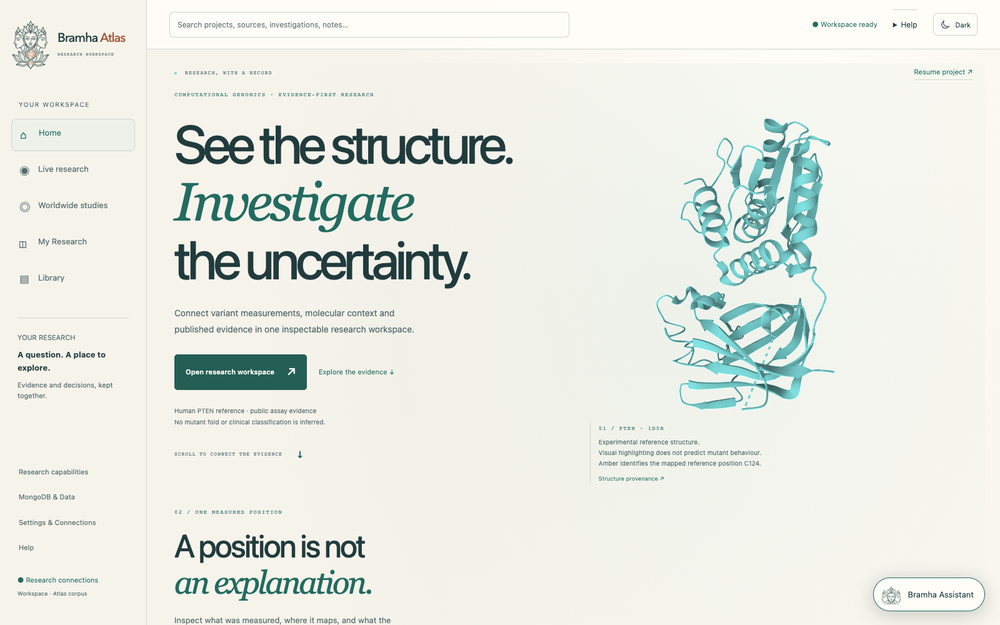
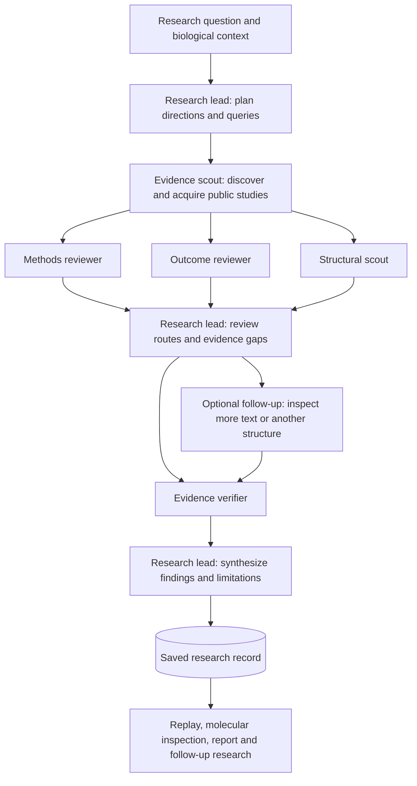
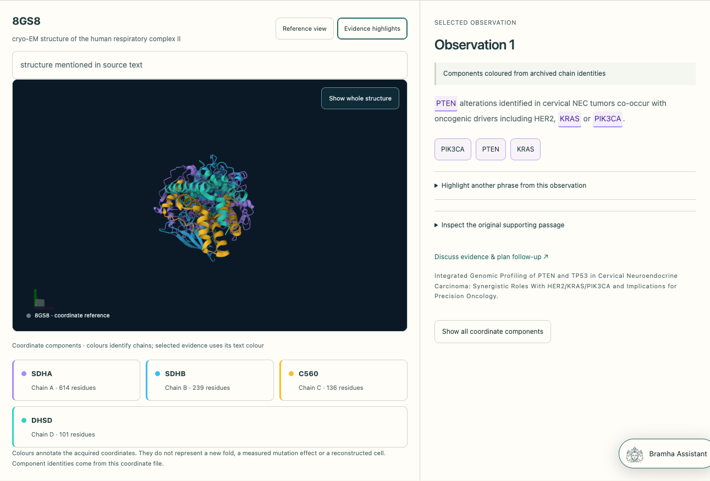
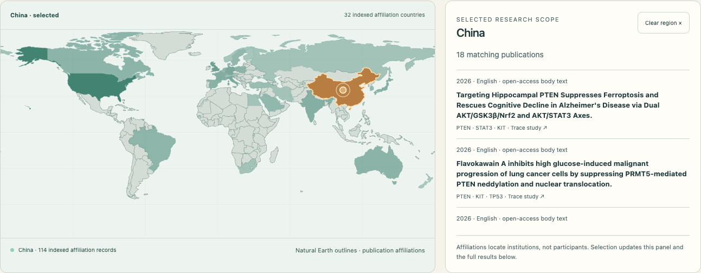
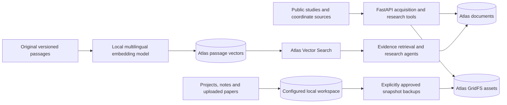
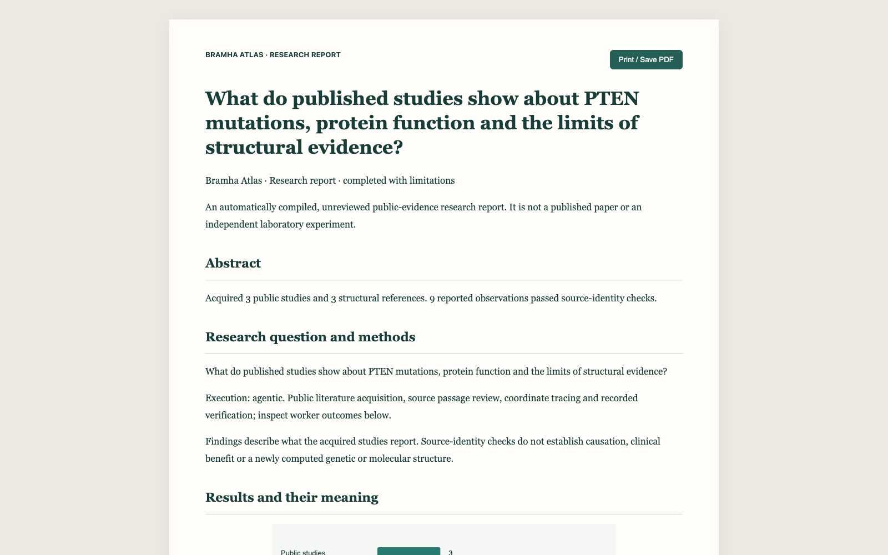

<div align="center">
  
  <h1>Bramha Atlas</h1>
  <p><strong>A multi-agent research observatory for biological evidence and molecular exploration.</strong></p>
  <p>Ask a question. Follow the agents. Inspect the evidence. Take the research with you.</p>
</div>



Bramha Atlas connects scientific questions with published studies, molecular structures, measured data and a visible team of research agents. A research lead plans the investigation, specialists work on separate evidence tasks, and verification and synthesis connect their outputs into a saved research record.

The product brings together **live multi-agent execution, multilingual literature, interactive molecular geometry, reproducible analysis and downloadable research reports**. Its React frontend and Python backend remain separate applications under [`variant-atlas/`](variant-atlas/).

## The multi-agent framework

An investigation is a sequence of executable assignments and evidence handoffs. The lead chooses a direction from the research question, delegates scoped work and reviews what the specialists return. Independent methods, outcomes and structure work can run concurrently after source acquisition.



| Agent | Responsibility | Inspectable output |
|---|---|---|
| **Research lead** | Plans ranked directions and source queries; reviews specialist results and decides whether to follow another path. | Plan, route decisions, assignments and execution events. |
| **Evidence scout** | Finds public studies and acquires available original text. | Publication identities, coverage, source versions and archived passages. |
| **Methods reviewer** | Examines the reported experimental system, design and comparability. | Source-linked observations and method limitations. |
| **Outcome reviewer** | Reviews reported findings, conflicting observations and unresolved evidence. | Findings tied to exact passages and source versions. |
| **Structural scout** | Traces molecular mentions and acquires coordinate references. | Experimental coordinates and publication-to-structure relationship checks. |
| **Evidence verifier** | Checks quotation identity, version references and permitted numerical claims. | Accepted observations, rejected claims and unresolved checks. |
| **Research lead · synthesis** | Reconciles checked reports and preserves limitations. | A saved research outcome with its supporting evidence. |
| **Bramha Assistant** | Helps the researcher discuss evidence and prepare further questions. | Cited explanations and research guidance, separate from the executing team. |

### Agent-to-agent coordination

- **Scoped assignments:** each worker receives a specific question and relevant upstream evidence.
- **Concurrent specialists:** independent reviews run together; downstream work waits for its required outputs.
- **Persisted handoffs:** messages record sender, recipient, purpose, timestamps and referenced source artifacts.
- **Adaptive follow-up:** the lead can inspect additional passages, trace another structural reference or finish the scoped review.
- **Verification before synthesis:** original quotations, source versions and numerical bindings are checked before final reconciliation.
- **Inspectable execution:** selecting an agent exposes its actual status, assignments, tools, handoffs and observations.
- **Durable outcomes:** completed, failed, cancelled and interrupted work retains its recorded evidence and history.

The framework uses application-level task and message contracts. Model decisions are translated into typed operations; scientific calculations and persistence execute in backend tools. The execution graph displays recorded work and public action summaries.


*An existing saved investigation, showing actual worker states and recorded handoffs.*

## From question to research result

1. **Frame the question.** Create a project or start from a published study. Choose biological context such as an organ, cell population, gene or molecular structure when known.
2. **Start from the workspace.** Launch research directly, even without selected evidence. Let the lead choose a public-evidence direction, or focus it on findings, structures or evidence gaps.
3. **Follow the team.** Inspect the saved plan, specialist work, tool activity, source acquisition and route changes in Live research.
4. **Explore molecular context.** Select evidence terms, chains or residues to connect an explanation with acquired coordinates and their provenance.
5. **Review the outcome.** Inspect supported observations, original passages, failed checks, missing evidence and limitations.
6. **Keep or share the work.** Reopen it through My Research, replay recorded steps, download a report or coordinate bundle, or explicitly create a revocable report link.

Expeditions have **no time deadline by default**. Optional deadlines range from a 30-second check to 24 hours. Each expedition still has a finite source scope and model-request budget, and it finishes when the assigned work is complete. Closing the browser tab leaves the backend task running; the backend process must remain available.

## Molecular exploration and practical analysis

The molecular workspace links scientific evidence to geometry rather than presenting an unexplained model.

- **Authentic reference structures:** acquired PDB/mmCIF coordinates rendered with Mol*.
- **Interactive evidence:** coloured terms and coordinate components connect observations to their structural context.
- **PTEN analysis:** native activity and abundance measurements, explicit missing values, audited sequence-to-structure mapping and quantitative comparisons.
- **Substitution proposals:** ideal amino-acid templates aligned to a reference backbone, with atom-distance screening and visible geometry differences.
- **Supplied-model comparisons:** alignment of uploaded coordinate models with saved provenance and comparison results.
- **Graphics recovery:** reduced-graphics retry, downloadable coordinates and a reference-derived 2D projection when browser 3D is unavailable.



*Colours identify selected evidence or coordinate components. Reference geometry and unrelaxed proposals retain explicit scientific labels.*

## Worldwide studies and multilingual research

Search published work, select an affiliation country on the map and inspect its publications beside the map. Study views connect the research question, methods, molecular mentions, structures, findings and limitations.

Original-language passages stay attached to their source identities. The library includes publisher-native material in languages including Chinese, Japanese and Russian. Translation preserves the original text for comparison and checks passage alignment and scientific identifiers. Language availability and acquired text coverage are shown explicitly.

Public evidence can be retrieved by keywords or multilingual semantic similarity through Atlas Vector Search. Adding a paper to a project preserves its source version and relationship to that project.



## Models and integration status

The Gemini integration targets are:

| Model | Role in the architecture | Current verification status |
|---|---|---|
| **`gemini-4-argon`** | Primary research-lead integration for planning, structured tool actions, route review and synthesis. The adapter supports background interactions and configurable thinking level. | Integrated and configured in the checked workspace; successful Argon generation is not established by the current verification records. |
| **`gemini-3.8-live-extended-thinking`** | Intended model target for the optional live voice and contextual navigation bridge. | A Google Live adapter is implemented; this exact model and an end-to-end live session have not been verified in the checked workspace. |

These are integration targets, not a claim that every displayed investigation used those models. Each saved run retains the model that actually produced its responses. No new biological or embedding model is trained by the application.

## Storage: Atlas, vectors and local research

MongoDB Atlas and Atlas Vector Search serve different purposes inside the same configured database, **`variant_atlas`**.



| Layer | What it stores or does |
|---|---|
| **Atlas documents** | Studies, passages, molecular entities, relationships, measurements, expeditions, worker tasks, events and saved guide records. |
| **Atlas Vector Search** | Meaning-based retrieval over embedded public passages; 384-dimensional multilingual vectors are generated locally. |
| **Atlas GridFS** | Archived source assets, molecular coordinate files and approved backup bytes. |
| **Local workspace** | The current configured project store, notes, uploaded papers and project investigations. Local corpus mode also supports SQLite and local assets. |

The public corpus and expedition store are configured independently of the project store. Approved local backups are snapshots; later local edits are not automatically synchronized. Public semantic retrieval and the local Library's keyword search remain distinct. Inspect the live configuration, records and storage flows in **MongoDB & Data** at `/data`.

## Reports, downloads and sharing

A stopped investigation can produce a paper-style report with its question, methods, observations, source quotations, structural context, plots, limitations and recorded research paths.

- **Read or print to PDF** from the formatted report.
- **Download Markdown or JSON** for discussion and reproducibility.
- **Download a ZIP bundle** with the report, available coordinate files, checksums and reference projections.
- **Draft an email** in the researcher's mail application, then attach downloaded files there.
- **Share deliberately:** an explicit action creates a frozen report snapshot with a revocable link. Nothing is shared automatically; the link requires a reachable server.



## Run locally

Requirements: **Python 3.11+**, **Node 22.12+**, npm, and a browser with WebGL for interactive 3D. Deterministic exploration and local storage work without external credentials; model execution requires configured access.

From the repository root:

```sh
cd variant-atlas
python3 -m venv backend/.venv
backend/.venv/bin/python -m pip install -r backend/requirements.txt
# First setup only: preserve an existing backend/.env.
cp -n .env.example backend/.env
backend/.venv/bin/python scripts/acquire_pten.py
backend/.venv/bin/python scripts/seed_research.py
npm ci --prefix frontend
```

Backend terminal, from the repository root:

```sh
cd variant-atlas/backend
.venv/bin/python -m app.server
```

Frontend terminal, from the repository root:

```sh
cd variant-atlas/frontend
npm run dev
```

Open **http://localhost:8500**. API documentation is available at **http://127.0.0.1:8000/docs**. See the [application setup guide](variant-atlas/README.md) for environment configuration, storage modes and test commands.

## Technical stack

| Area | Implementation |
|---|---|
| Frontend | React, TypeScript, Vite, React Router, Three.js and Mol*. |
| Backend | Python, FastAPI, typed Pydantic contracts and asynchronous worker orchestration. |
| Scientific computation | Biopython, NumPy, DuckDB and PyArrow. |
| Model integration | Google GenAI structured interactions and a backend-mediated Live WebSocket bridge. |
| Storage and retrieval | MongoDB Atlas, GridFS, Atlas Vector Search, local multilingual embeddings and local workspace persistence. |
| Verification | Pytest, Playwright, source/version checks, numerical binding checks and saved execution records. |

## Scientific scope and current boundaries

Bramha Atlas reconstructs and analyses evidence. Acquiring a structure does not establish a mutation effect or create a new protein fold. Unrelaxed geometry proposals are not validated functional predictions. Source-identity checks do not establish scientific truth, causation, clinical benefit or a cure.

Published evidence, computed checks, proposed experiments and synthetic planning templates retain separate labels. Missing measurements stay missing. The current application is a single-user research prototype; authentication, multi-user isolation, public hosting and automatic recovery of an interrupted worker process are not implemented.

The most recent backend verification completed **174 tests**, alongside targeted browser checks for real tool execution, no-evidence research start, saved replay, report downloads, share revocation and graphics recovery. Screenshots above were captured from the running app using existing public research records; capturing them did not start new investigations.

## Further documentation

- [Setup and development](variant-atlas/README.md)
- [Connected research workflow and routes](variant-atlas/docs/RESEARCH_WORKFLOW_ROUTES.md)
- [Real-data provenance and audited PTEN build](variant-atlas/docs/REAL_DATA_BUILD.md)
- [Executable analysis and visual results](variant-atlas/docs/EXPERIMENT_ANALYSIS_DELIVERY.md)
- [MongoDB & Data console](variant-atlas/docs/MONGODB_DATA_CONSOLE.md)
- [Visual source inspection](variant-atlas/docs/LIBRARY_VISUAL_EVIDENCE.md)
- [Brand assets and light/dark themes](variant-atlas/docs/BRAND_AND_THEME.md)
