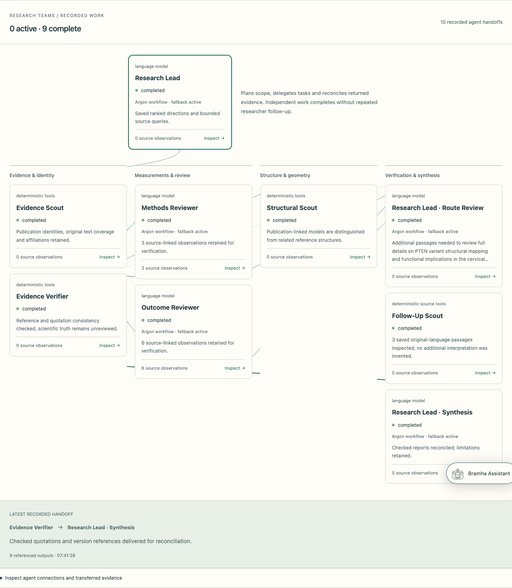

# Bramha Atlas — setup and development

Bramha Atlas is a multi-agent research observatory connecting published evidence, molecular structures, quantitative analysis and saved research reports.

See the **[main project README](../README.md)** for the product overview, multi-agent architecture, model integration status, diagrams and current application screenshots.



## Requirements

- Python **3.11+**.
- Node **22.12+** and npm.
- A browser with WebGL for interactive molecular rendering. Coordinate downloads and reference projections remain available when 3D cannot render.
- Internet access for initial dependency installation and public scientific data acquisition.

The frontend and backend have separate dependencies and communicate through HTTP. Credentials stay on the backend.

## Install

From the repository root:

```sh
cd variant-atlas
python3 -m venv backend/.venv
backend/.venv/bin/python -m pip install -r backend/requirements.txt
# First setup only; retain any existing credentials and storage settings.
cp -n .env.example backend/.env
backend/.venv/bin/python scripts/acquire_pten.py
backend/.venv/bin/python scripts/seed_research.py
npm ci --prefix frontend
```

The acquisition command downloads supported scientific reference assets and builds the audited PTEN workspace. The seed command prepares the local research data. Synthetic fixtures remain explicitly separate at `/developer/demo`.

## Configure the backend

Edit `variant-atlas/backend/.env`. The following is a local-mode baseline; use your own credentials where required:

```dotenv
BACKEND_HOST=127.0.0.1
BACKEND_PORT=8000
FRONTEND_ORIGIN=http://localhost:8500
APP_PROFILE=local
DATA_MODE=real
DATA_BACKEND=local
CORPUS_BACKEND=local
CORPUS_EMBEDDINGS=disabled
LLM_PROVIDER=mock
```

Local mode supports navigation, saved projects and deterministic scientific tools without model or database credentials. Mock explanations are explicitly labelled; they do not verify model execution. In Live research, select **Public data tools only** if model access is not configured.

### Gemini integrations

```dotenv
GOOGLE_API_KEY=your_google_api_key
LLM_PROVIDER=google
ARGON_MODEL=gemini-4-argon
GOOGLE_THINKING_LEVEL=medium
GOOGLE_BACKGROUND=true
```

`gemini-4-argon` is the primary research-lead integration target. The structured action adapter supports background interactions, planning and typed tool decisions. Configured access does not establish successful generation; the checked workspace's Argon verification remains pending.

The optional Live voice bridge accepts an exact account-supported model through:

```dotenv
# Intended target; verify account access and a real Live session before claiming use.
GEMINI_LIVE_MODEL=gemini-3.8-live-extended-thinking
```

The backend-mediated Live adapter is implemented. The exact Live model above and an end-to-end voice session are not verified in the current workspace. Text navigation remains available.

### MongoDB Atlas and vector retrieval

To store the public corpus and expedition records in Atlas:

```dotenv
CORPUS_BACKEND=atlas
MONGODB_URI=your_mongodb_connection_string
MONGODB_DATABASE=variant_atlas
CORPUS_EMBEDDINGS=local-multilingual
CORPUS_EMBEDDING_MODEL=sentence-transformers/paraphrase-multilingual-MiniLM-L12-v2
```

`DATA_BACKEND` and `CORPUS_BACKEND` select separate stores. The current application uses local project storage and Atlas for the public research corpus. Enabling Atlas for the corpus does not migrate local project files. Approved backups remain additive snapshots.

The 384-dimensional passage vectors live in the same Atlas database as the documents. Atlas Vector Search uses `bramha_passages_multilingual_v1`. Embedding generation and index verification are explicit operations; changing configuration alone does not embed every passage. Inspect current coverage and index status at `/data`.

Configuration precedence is process environment → `backend/.env` → application-root `.env` → defaults. Environment files are ignored by Git. Do not put provider or database secrets in frontend variables.

## Start the servers

Backend terminal, from the repository root:

```sh
cd variant-atlas/backend
.venv/bin/python -m app.server
```

Frontend terminal, from the repository root:

```sh
cd variant-atlas/frontend
npm run dev
```

| Address | Purpose |
|---|---|
| `http://localhost:8500` | Bramha Atlas application. |
| `http://127.0.0.1:8000/docs` | Interactive FastAPI documentation. |
| `http://127.0.0.1:8000/api/health` | Backend readiness. |

The local launcher requires a loopback backend host. Vite proxies `/api` to the backend. Production hosting needs a separate serving configuration, authentication and workspace isolation; `npm run preview` does not provide the development API proxy.

## Product routes

| Route | Research surface |
|---|---|
| `/` | Molecular overview and research entry. |
| `/research` | Projects and saved research team records. |
| `/research/new` | Question and research-area setup. |
| `/research/:projectId/workspace` | Biology selection, evidence discovery and method-specific exploration. |
| `/research/:projectId/results` | Saved investigations and linked public expeditions. |
| `/observatory` | Live research team, workbench, recorded paths and replay. |
| `/worldwide` | Publication search and country map. |
| `/worldwide/:studyId` | Source-linked study reconstruction and molecular context. |
| `/library` | Shared source catalogue and visual source inspection. |
| `/data` | Atlas documents, vector coverage, backups and local storage inventory. |

## Framework and repository layout

```text
variant-atlas/
├── frontend/
│   ├── src/agents/                 # Shared agent graph and model presentation
│   ├── src/observatory/            # Team theater, worldwide studies and reports
│   ├── src/workspace/              # Projects, biology pool and scientific viewers
│   └── e2e/                       # Isolated browser tests
├── backend/
│   ├── app/expeditions.py          # Public research orchestration and handoffs
│   ├── app/expedition_reports.py   # Reports, coordinate projections and sharing
│   ├── app/orchestration/          # Typed scientific investigation workflows
│   ├── app/providers/             # Structured model and Live audio adapters
│   ├── app/world_research.py       # Public acquisition and semantic retrieval
│   ├── app/corpus_store.py         # Atlas/local corpus persistence and GridFS
│   └── tests/                     # Contracts, computations and persistence tests
├── scripts/                       # Data preparation and explicit ingestion tools
├── docs/images/                   # Screenshots embedded in the main README
├── data/                          # Fixtures and locally acquired scientific assets
└── var/                           # Ignored local runtime state
```

The lead delegates scoped work through typed tasks and persisted evidence messages. Methods, outcome and structural specialists can operate concurrently; route review, verification and synthesis depend on their returned work. The assistant is separate from the executing team. See the [main architecture diagram](../README.md#the-multi-agent-framework).

Public expeditions have no deadline by default. Optional deadlines do not remove source or request budgets. Other scientific investigation methods retain their own declared limits. A running backend continues after a browser tab closes; a stopped process preserves records but does not automatically resume its workers.

## Verification

From `variant-atlas/`:

```sh
(cd backend && .venv/bin/python -m pytest -q)
npm run build --prefix frontend
```

For browser tests, install Chromium once:

```sh
cd frontend
npx playwright install chromium
npm run test:e2e
```

Playwright starts isolated test servers and local data. It does not reuse the running application. To avoid the default development ports, set `PW_FRONTEND_PORT` and `PW_BACKEND_PORT`:

```sh
PW_FRONTEND_PORT=8530 PW_BACKEND_PORT=8030 npm run test:e2e
```

`PLAYWRIGHT_CHROMIUM_EXECUTABLE_PATH` can select an existing compatible Chromium executable. The latest backend verification passed **174 tests**. Targeted browser checks cover no-evidence research start, persisted tool work, replay without re-execution, report downloads, consent-based sharing and revocation, molecular graphics recovery and responsive layouts.

## Scientific and operational scope

Public-source reports, quoted observations, computed checks, unrelaxed geometric proposals and synthetic planning templates retain their respective labels. Reference coordinates do not establish a mutation's effect. Verification of quotation identity is not scientific validation or a clinical conclusion.

Reports and coordinate bundles can be downloaded. Email actions prepare a draft in the user's mail application. Shared report links require an explicit choice, create a frozen snapshot and can be revoked; remote access requires a reachable server. This is a single-user research application, without multi-user accounts or public hosting built in.
