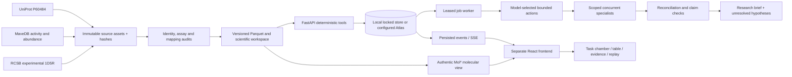
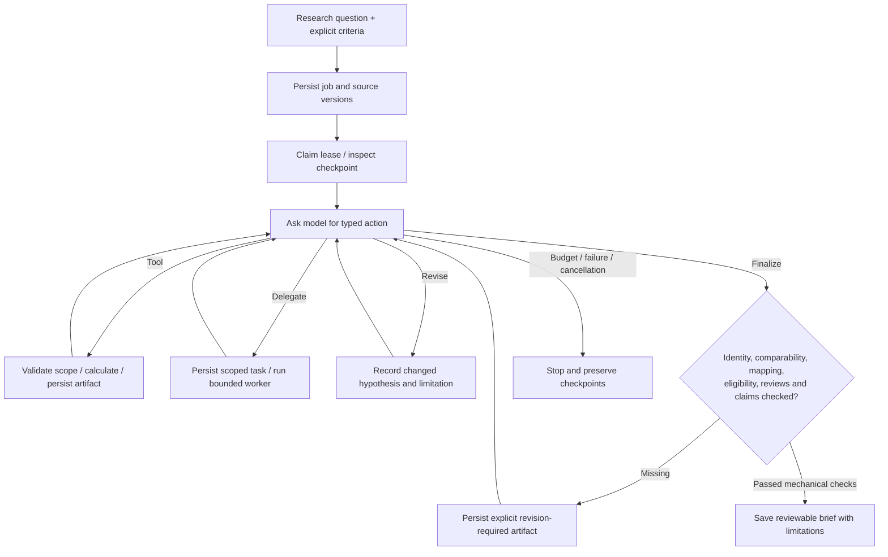

# Variant Atlas: evidence before explanation

The model chooses work; deterministic tools decide eligibility, native-score calculations and whether coordinates support a distance. Persisted artifacts connect those decisions to the final output. A completed run means the bounded workflow ended with stated limitations; it does not prove its hypotheses.

Provider labels, scientific data labels, storage labels and playback labels remain separate. An OpenRouter run on authentic PTEN data is real scientific-data execution, but is not an Argon challenge submission. Local lexical retrieval is not Atlas hybrid search. A replay is recorded playback, not a running model.
