# Bramha Atlas — connected research workflow

**Discussion document · 24 October 2026**

> This records the discussion map before the final product refactor. See [Final experience implementation](FINAL_EXPERIENCE_IMPLEMENTATION.md) for the implemented navigation, current capabilities, route map and verification.

**Purpose:** explain how a researcher moves through Bramha Atlas, what each screen should show, and how structures, sources, agents and findings connect. Use this document with a researcher, designer or engineer to agree on the product flow before changing more screens.

**Status:** this is a map of the existing application plus a proposed visual experience. Diagrams and wireframes below describe the intended experience; they are not screenshots or claims that every interaction already exists. Sections explicitly distinguish current functionality from proposed changes.

## 1. The product in one sentence

Bramha Atlas is a research workspace where a researcher inspects a molecular structure or biological comparison, proposes a change, investigates it against traceable evidence, and records what the evidence supports or leaves unresolved.

For the present product, the supported methods are **PTEN variant investigation** and **blood-group comparative evidence review**. Blood-group work is one method inside the same project workflow, not a separate product.

### The complete journey

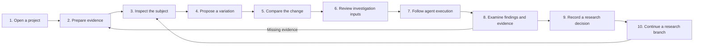

Plain-text version: **Project → Sources → Inspect → Propose → Compare → Review inputs → Run → Verify → Record → Iterate.**

Researchers may revisit earlier steps. The numbered path provides orientation; it should not force a rigid wizard around every exploration action.

## 2. What is confusing today

The existing application has project routes, a shared source catalogue, method-specific exploration, saved investigations and a notebook. The weakness is the visual connection between these parts.

| Current experience | Why it is confusing | Proposed correction |
| --- | --- | --- |
| Several navigation areas describe different parts of the same research task | The researcher must remember where the task went | Show the active project, selected subject and investigation context consistently |
| Sources and investigations open as separate screens | It is difficult to see which evidence will feed which run | Show a source-to-input handoff with pinned versions and inclusion state |
| A selected residue can look like an isolated viewer interaction | The scientific meaning and available next actions are unclear | Open an anchored inspector with identity, measurements, evidence and permitted actions |
| Agent paths can appear as technical status cards | People see execution labels without understanding the question being tested | Draw branches with a question, chosen tool, reason, result and evidence link |
| Playback controls resemble a generic slider | It is unclear what changed at the selected time | Pair the event cursor with a visible event description and highlighted affected objects |
| Structure, criteria and evidence changes are scattered | The researcher cannot quickly compare before and after | Use one explicit comparison view and a saved change record |

**Core design requirement:** every handoff must show **what moves forward, why it moves forward, and what the next screen will do with it**.

## 3. A stable screen structure

Keep one application shell. Within a project, preserve the project context while replacing the main working area with the selected task. A molecular viewer should lead the **Explore** screen; it should not sit permanently above Sources, Notebook or run details.

```text
┌────────────────────────────────────────────────────────────────────────────┐
│ Bramha Atlas     Project: PTEN function study        Saved / Saving / Error│
├────────────────┬───────────────────────────────────────────────────────────┤
│ Home           │ Project → Explore → selected substitution                │
│ Projects       │                                                          │
│ Sources        │ CURRENT TASK: inspect / compare / run / review           │
│ Investigations │                                                          │
│ Methods        │ Main scientific view             Context inspector       │
│ Settings       │ Structure, evidence or run       Selection and evidence  │
│                │                                                          │
│ Project area   │                                                          │
│ Overview       │                                                          │
│ Sources        ├───────────────────────────────────────────────────────────┤
│ Explore        │ Handoff: selected objects + evidence + next action       │
│ Investigations │ Example: 2 substitutions → Review investigation inputs   │
│ Findings       │                                                          │
│ Notebook       │                                                          │
└────────────────┴───────────────────────────────────────────────────────────┘
```

**Already exists:** global navigation, project navigation, separate main pages and stable deep links.

**Proposed:** a consistent task-context strip and handoff summary across those pages. Desktop can use a side inspector; mobile should use a labelled sheet with a clear close/return action. Do not cover the whole structure with automatically opening pop-ups.

## 4. The ten steps, with a visual handoff at every step

### Step 1 — Open or create a research project

**Researcher action:** resume a saved project, or create one with a title, objective and supported method.

**Screen should show:** the objective, method, saved work and evidence readiness. Resume should return to meaningful saved context rather than an unrelated default scene.

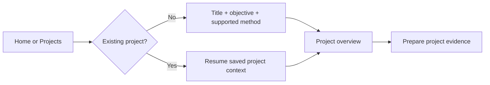

**Handoff:** project identity and objective remain visible on the next screen.

**Current:** project creation and overview exist; required reference packages can be linked explicitly. **Proposed:** a compact visual readiness path showing the completed and missing steps.

### Step 2 — Prepare and connect sources

**Researcher action:** inspect the shared library, import a supported paper, and link eligible source versions to the project.

**Screen should show:** a visual evidence chain, plus a usable table for detailed work. Each source needs its origin, version, preparation state and actual investigation coverage.

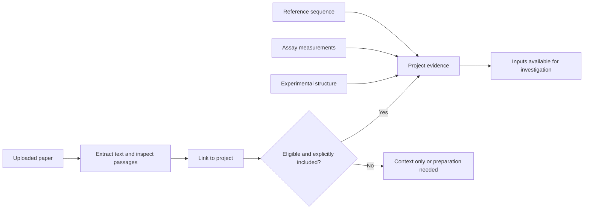

**Handoff:** “These source versions will be used; these other documents are linked as context only.” A document being uploaded, linked and used in a model request are three different states.

**Current:** shared Sources, project links, extraction, version records and explicit optional-paper inclusion exist. PDF, UTF-8 text and Markdown uploads are supported, up to 8 MB. Scanned PDFs need OCR; OCR is not implemented. Source reading uses an explicit model request covering at most the first 12 extracted passages. PTEN runtime inclusion supports at most three papers and six passages per paper. Blood investigations use the fixed inspected corpus; newly uploaded papers do not automatically enter that engine.

**Proposed:** connected evidence cards and a visible coverage preview. For non-English papers, show original text beside the model interpretation, its response language and exact supporting passages. Original-language extraction exists; reliable reading in a particular language still requires actual provider verification.

### Step 3 — Inspect the molecular or comparison subject

**Researcher action:** rotate or zoom the structure, select a residue, or choose a biological comparison scenario.

**Screen should show:** the scientific subject as the main working area, with an inspector anchored to the selected object.

```text
┌──────────────────────── EXPLORE ──────────────────────────────────────────┐
│ PTEN · experimental reference structure · source and mapping available   │
├─────────────────────────────────────┬────────────────────────────────────┤
│                                     │ SELECTED POSITION                  │
│            Molecular view           │ Canonical identity and mapping    │
│                  ● selected residue │ Measured substitutions, if any    │
│                                     │ Activity / abundance / missing data│
│                                     │ Supporting evidence               │
│                                     │ [Inspect alternatives] [Compare]  │
└─────────────────────────────────────┴────────────────────────────────────┘
```

**Handoff:** the selected residue or scenario becomes the explicit subject of the next action. Zoom alone changes the camera; it should not silently create a hypothesis or start an investigation.

**Current:** experimental PTEN geometry, audited mappings, measured variants and contextual exploration exist. **Proposed:** consistent selection-linked explanations and a small “Research this selection” entry point, with an explicit control for live model assistance.

### Step 4 — Propose a variation

**Researcher action:** choose a measured substitution, add it to a comparison, or ask the assistant for evidence-based exploration options.

**Scientific terminology:** a protein contains amino-acid residues. Replacing a residue is a substitution. Adding or deleting residues changes the sequence. Adding a whole protein is a different interaction or complex-modelling task. These operations need different tools and evidence; they should not all be called “adding protein cells.”

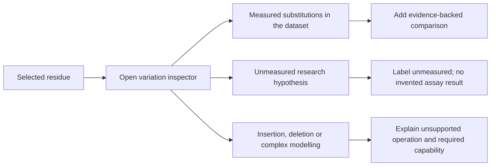

**Handoff:** a change card states the original identity, proposed alternative, source of the suggestion and what the application can actually evaluate.

**Current:** PTEN is a descriptive single-substitution workflow with comparison proposals. Arbitrary insertion/deletion modelling, protein docking and mutant folding are not implemented. **Proposed:** drag-and-drop comparison tokens and a contextual change menu, with keyboard equivalents. Dropping a token stages a comparison; it does not demonstrate a physical protein modification.

### Step 5 — See exactly what changed

**Researcher action:** compare the staged variation with the reference or another measured substitution.

**Screen should show:** synchronized selection, an explicit change summary and comparable evidence. Distinguish a changed selection or colour overlay from a computed change in molecular coordinates.

```text
┌────────────────── REFERENCE ─────────────────┬──────── COMPARISON ────────┐
│ Experimental geometry                       │ Same reference geometry   │
│ Selected canonical position highlighted     │ Alternative highlighted   │
├─────────────────────────────────────────────┴────────────────────────────┤
│ CHANGE: selected substitution A → selected substitution B               │
│ EVIDENCE: activity | abundance | mapping | source coverage               │
│ GEOMETRY STATUS: no computed mutant structure                           │
│ [Undo selection change]                 [Review investigation inputs]    │
└──────────────────────────────────────────────────────────────────────────┘
```

**Handoff:** the selected alternatives, evidence coverage and criteria carry into input review. A new criterion should visibly update the candidate set and show which candidates entered or left it.

**Current:** selection, criteria, journal and explicit change/undo mechanisms exist. **Proposed:** one consistent before/after comparison surface and change markers across the viewer and evidence panel. A true geometric difference view would require independently produced structures, aligned coordinates, provenance and uncertainty; it cannot be manufactured by deforming the existing reference mesh.

### Step 6 — Review the investigation before starting

**Researcher action:** confirm the question, selected objects, source versions, criteria and execution limits.

**Screen should show:** a compact visual manifest, followed by an explicit start action.

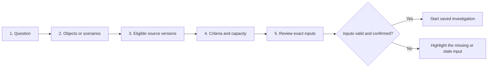

**Handoff:** freeze the submitted inputs and create a run identity. Later workspace edits must not silently rewrite this investigation.

**Current:** this five-step review exists, including source readiness checks, explicit selection, capacity limits and confirmation. **Proposed:** richer visual summaries and clear links back to the exact input that needs correction.

### Step 7 — Follow actual agent execution

**Researcher action:** inspect the running investigation, open a worker or tool result, and follow explored or deferred branches.

**Screen should show:** a map of actual execution events. Branches explain the research question being addressed, not just an internal tool name.

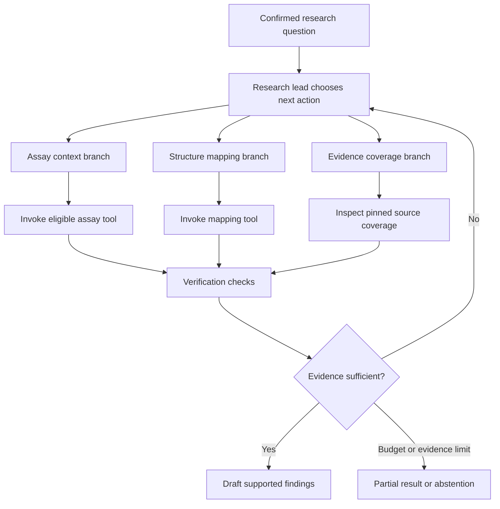

This is an **illustrative execution pattern**, not a fixed plan promised for every run. The real graph must come from recorded assignments, tool calls, outputs and transitions.

**Branch inspector:** question → why this path → assigned role → actual tool → evidence/output → remaining uncertainty → next action. Keep technical JSON available under details, rather than making it the primary explanation.

**Handoff:** each completed branch links to saved artifacts and claims. Proposed, executing, completed, failed and parked paths must look different. A parked path should explain why it was deferred.

**Current:** orchestration, role specifications, tools, events, saved artifacts and an investigation chamber exist. **Proposed:** clearer branch explanations and selection-linked highlighting. Show only the paths actually proposed or explored; do not fabricate ten paths or hundreds of tools to make the scene look busy. An event graph represents observable execution, not private model reasoning.

### Step 8 — Examine outcomes, citations and recorded replay

**Researcher action:** open a finding, inspect its supporting evidence and checks, and replay the events that produced it.

**Screen should show:** the finding connected to its provenance and uncertainty.

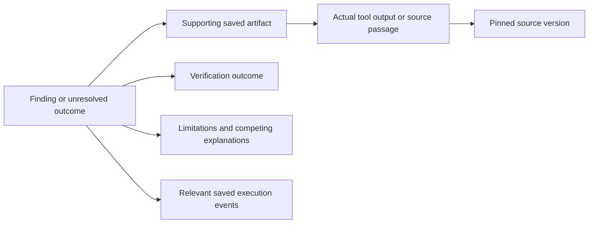

**Replay visualization:**

```text
LIVE / RECORDED                         Event 14 of 28
○────○────●────○────○                   Selected: structure mapping saved
         ↑ selected event              Affected branch: mapping review
                                       Output: inspect saved mapping artifact
[Previous] [Next] [Return to live]      Difference from previous event: …
```

**Handoff:** “This is what the run produced, this is its support, and this is what still needs review.” Returning to live restores the latest persisted state. Replay must not rerun tools or overwrite the final result.

**Current:** canonical run tabs, evidence artifacts, activity and recorded replay exist. **Proposed:** an event-specific explanation, affected-node emphasis and clearer live/recorded styling. A check passing confirms its stated mechanical condition; it does not establish clinical validity or scientific consensus.

### Step 9 — Record the researcher's decision

**Researcher action:** save an interpretation, disagreement, review note or unresolved question in the project notebook.

**Screen should show:** the researcher’s decision beside the original run status and evidence links, preserving authorship.

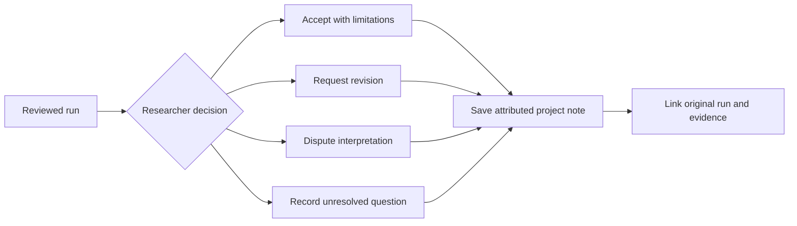

**Handoff:** a saved decision becomes the rationale for further research. Researcher approval should not overwrite the original tool output or turn an unmeasured hypothesis into an experimental result.

**Current:** backend-persisted notes, run-linked review notes and PTEN review records exist. **Proposed:** a visual decision card with the original outcome, review and follow-up shown together. Reviewer identity is locally self-reported; independent reviewer authentication is not implemented.

### Step 10 — Continue a traceable research branch

**Researcher action:** change a comparison, add evidence, adjust criteria or investigate an unresolved question.

**Screen should show:** how the new investigation differs from the previous one.

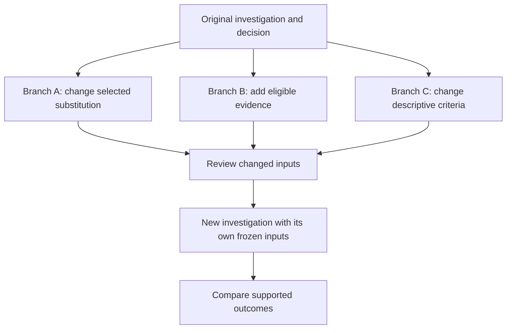

**Handoff:** retain the previous run unchanged, identify the changed inputs and record the reason for the new work.

**Current:** researchers can return to exploration, save journal changes and start follow-up runs. **Proposed:** explicit parent/child investigation links, a branch tree and cross-run input/outcome comparison. These should not be presented as already implemented.

## 5. How Sources and Investigations connect

These are related objects with different responsibilities, rather than competing navigation destinations.

| Object | Responsibility | Example |
| --- | --- | --- |
| Project | Holds the research objective and related work | PTEN function study |
| Source | Identifies an evidence item and its provenance | Assay dataset, sequence, structure or paper |
| Project-source link | Pins a version and records intended use | Linked as context or explicitly included where eligible |
| Exploration state | Records what the researcher is inspecting | Selection, comparison and descriptive criteria |
| Investigation | Executes a reviewed question against frozen inputs | One bounded computational run |
| Artifact | Stores a tool result or verification output | Mapping audit or coverage result |
| Finding | States an outcome with support and limitations | Source-linked observation or explicit abstention |
| Notebook entry | Records a researcher's interpretation or decision | Review note linked to the run |

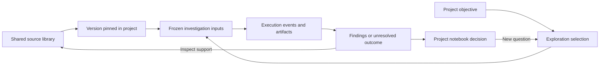

**Required interaction:** clicking a source should show the projects and runs that use it. Clicking a finding should take the researcher to the exact evidence version used by that run, with a return path to the finding.

## 6. Two concrete journeys to discuss

### A. PTEN molecular investigation

1. Open a PTEN project and confirm its objective.
2. Inspect the pinned sequence, assays and experimental structure sources.
3. Open Explore; select a measured substitution such as `p.C124S` and inspect its mapping and native-scale measurements.
4. Add another available measured substitution to the comparison. The UI highlights the corresponding reference positions and explains any missing mapping or measurement.
5. Inspect differences in evidence, without implying a newly computed mutant fold.
6. Review the exact question, selected substitutions, source versions, criteria and capacity; explicitly start.
7. Follow the actual agent/tool branches and inspect saved outputs.
8. Review findings, limitations and verification; record a decision and any follow-up question.

```text
Measured substitution → Reference position → Evidence comparison
                     → Reviewed run → Saved artifacts → Researcher decision
```

This journey describes evidence inspection and computational analysis. It is not a claim of a wet-lab experiment, diagnosis or protein repair.

### B. Blood-group comparative evidence investigation

1. Create or open a project using the blood-group evidence method.
2. Inspect the required fixed evidence corpus in project Sources.
3. Choose reported comparison scenarios, for example O positive and B negative.
4. Show that **both ABO and RhD differ**, then offer comparisons that hold one factor constant.
5. Review the question and evidence applicability; explicitly start.
6. Follow actual evidence review, verification and reconciliation work.
7. Review which claims the corpus supports and where it cannot establish a distinction.
8. Save the review in the same project notebook flow used by PTEN projects.

```text
Reported scenarios → Separate ABO / RhD factors → Inspect applicability
                   → Reviewed evidence run → Supported / unsupported claims
```

The comparison is not a measured genotype or an individual disease-risk estimate. The current corpus does not establish a RhD-specific malaria distinction.

## 7. The agent's role at each point

| Researcher context | Helpful agent interaction | Required visible evidence |
| --- | --- | --- |
| Selected residue | Explain identity, available measurements and possible evidence questions | Mapping and measurement sources |
| Proposed comparison | Explain what differs and which interpretations remain unmeasured | Explicit input difference and coverage |
| Imported paper | Provide a requested-language reading with original-language support | Extracted passage, exact quote and coverage |
| Investigation start | Choose and execute eligible tools within the reviewed scope | Actual provider, assignments and tool events |
| Branch change | Explain the observable result that motivated a new direction | Previous output and recorded transition |
| Outcome review | Identify support, contradictions and missing evidence | Artifacts, checks and cited source versions |

The agent should suggest options without taking control away from the researcher. Selecting or zooming a structure should not automatically launch a costly run. Available roles are specifications; active workers are the assignments recorded in a particular investigation.

**Provider status at this document's date:** the Google key could access a model catalogue listing `gemini-4-argon`, but generation checks returned a rate-limit error and a timeout. Successful Argon generation is not verified. UI navigation and deterministic exploration must remain usable when provider execution is unavailable.

## 8. What is stored, and where

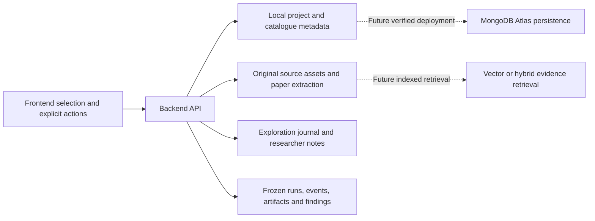

- **Current local storage:** project/catalogue metadata defaults to `var/portfolio/metadata.json`; scientific assets, papers, journals and run snapshots use their existing backend stores. Catalogue links reference evidence rather than duplicating every original file.
- **Browser drafts:** unfinished investigation inputs are retained in `sessionStorage` for the current browser tab. This is not a durable backend archive or cross-device resume.
- **Atlas:** adapters exist, but a live Atlas deployment has not been verified in this environment. Migration needs to preserve source IDs, pinned versions, history and frozen requests.
- **Retrieval:** current catalogue search is lexical. Vector or hybrid retrieval should return identifiable passages with provenance; a similarity match would not make a passage scientifically applicable by itself.
- **Save feedback:** a proposed consistent indicator should distinguish saving, saved and failed. Do not imply that an unsent browser interaction has already reached durable storage.

## 9. Implementation order for a coherent product

This is a proposed sequence of work, not a claim that these refinements are complete.

| Order | Deliverable | Visible completion condition |
| --- | --- | --- |
| 1 | Consistent project/task context and handoff summary | Every main screen shows the current project, task and relevant next action |
| 2 | Sources-to-input evidence visualization | A researcher can see linked, included, unavailable and stale sources without reading JSON |
| 3 | Selection-linked molecular inspector | Selecting an object exposes identity, evidence, permitted actions and return context |
| 4 | Unified variation and comparison flow | A staged change shows before/after evidence and honest geometry status, with undo |
| 5 | Investigation input handoff | Exact selections and eligible versions are visible before explicit start |
| 6 | Readable execution map and replay | A selected branch/event explains its actual action, output and state change |
| 7 | Findings-to-evidence and notebook decision cards | Each outcome links to support, uncertainty and the researcher's attributed decision |
| 8 | Explicit follow-up lineage | A new run shows its parent, changed inputs and reason; the original run remains unchanged |

## 10. Walkthrough acceptance checklist

Use these questions while walking through the product with someone unfamiliar with it:

- Can they identify the active project, method and selected subject on every relevant screen?
- Can they explain why a source is linked, whether it is used, and which version a run used?
- Does opening a navigation item visibly replace the main working area and preserve the project context?
- Does selecting a residue reveal understandable evidence and a clear permitted next action?
- Can they distinguish a changed selection, a measured substitution and a computed structural model?
- Can they see what carries from exploration into the investigation input review?
- Can they distinguish a suggested path from a real tool call or completed worker assignment?
- Does replay explain the selected event and return cleanly to the latest persisted state?
- Can they navigate from a finding to evidence and back without losing their place?
- Can they see what was saved and distinguish a researcher note from a model/tool result?
- Can they complete the journey with keyboard controls and on mobile without relying on hover or animation?
- When evidence, geometry, storage or a model is unavailable, is that state visible with an appropriate next action?

## 11. Decisions for the discussion

| Decision | Suggested starting position |
| --- | --- |
| What should lead a project exploration session? | Saved scientific subject and selection, with the structure prominent for PTEN |
| Where should assistant explanations appear? | One selection-linked inspector, expanding into a focused comparison when needed |
| What does drag-and-drop mean in the first version? | Stage supported substitution comparisons; label unsupported modelling separately |
| When should model execution start? | Explicit request for assistance, or confirmed investigation start |
| How should sources appear during exploration? | Compact provenance/coverage cards opening canonical source details |
| How should the researcher continue prior work? | Resume saved context now; add explicit investigation branch lineage as a separate improvement |
| What future capability matters most? | Agree whether validated structural modelling, broader evidence ingestion or retrieval comes next |

### Suggested opening for the conversation

> “I want Bramha Atlas to feel like one continuous research workflow. The researcher starts from a scientific subject, sees evidence tied to each selection, stages a supported variation, reviews the exact inputs, watches actual agent work, then records a traceable decision. The diagrams show the intended handoffs. Which parts are scientifically useful, and which interactions should we simplify?”

## 12. Basis for the current-state statements

The current-state map was checked against the local implementation and existing documentation. These references are optional; the workflow above is readable as a standalone shared Markdown file.

- [Current routes, feature migration and persistence](RESEARCH_WORKFLOW_ROUTES.md)
- [Home molecular overview and provider verification](MOLECULAR_OVERVIEW.md)
- [Workspace routes and shell](../frontend/src/workspace/WorkspaceApp.tsx)
- [Exploration, investigation review, run detail and notebook](../frontend/src/workspace/Science.tsx)
- [Shared Sources, source preparation and usage](../frontend/src/workspace/Sources.tsx)
- [Project/catalogue backend](../backend/app/portfolio.py)

The diagrams use Mermaid, supported by GitHub and compatible Markdown viewers. Each stage also has a written handoff; the screen layouts use plain text so the document remains understandable in viewers that do not render Mermaid.
