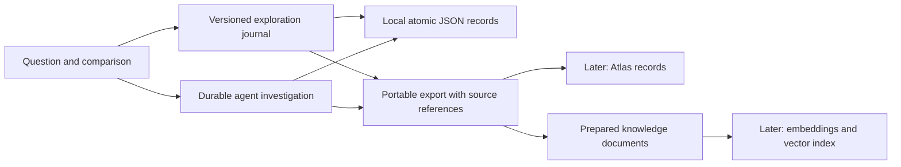

# Bramha Atlas: molecular research workbench

> The current production journey is project-centred. See [Research workflow, routing and storage migration](RESEARCH_WORKFLOW_ROUTES.md). Older standalone layouts below remain developer regression surfaces; project sources require separate explicit paper inclusion before investigation.

The product is now **Bramha Atlas** (B-R-A-M-H-A). The existing frontend/backend split, workspace layout, datasets, source identifiers and experimental reference structure remain intact. Repository folder names and historical research records retain their original identifiers.

## Default workspace

The experimental molecular scene is the main workspace. A measured-substitution palette supports drag/drop comparison edits, a position inspector explains native assay values and mapping gaps, and the command dock directs bounded investigations. Comparison protocols, papers, criteria, changes and detailed records open from the toolbar. The product does not begin with a research-question presentation.

Experimental source identity and reference limitations are available in the inspector. Opening an investigation binds its saved selected IDs and criteria to the scene. The source identifier 1D5R is provenance, not the product's main heading.

## Agent collection

Open `/?page=agents`. Seven specifications correspond to actual roles implemented by the research engine:

| Role | Responsibility |
|---|---|
| Research lead | Plan paths, delegate scoped work, reconcile and finalize or abstain |
| Sequence identity reviewer | Check substitutions against the pinned reference |
| Measurement reviewer | Inspect activity, abundance, scale and experimental context |
| Spatial evidence reviewer | Validate mappings and calculate reference-space distances |
| Research evidence reviewer | Retrieve permitted methods and annotations |
| Evidence and numbers verifier | Check artifact references, numeric claims and shortlist rules |
| Review reconciler | Retain agreements, disagreements and unresolved limitations |

Each profile shows inputs, outputs, recommended tools, permissions, limits, when to use it, and actual queued/running tasks from saved investigations. Available roles are not displayed as running agents. Requesting a specialist prepares the workspace and adds that role to `requested_roles`; finalization requires its completed, non-abstained review. This requirement shares the existing request/time/tool budgets and may lead to abstention.

## Visual identification of changes

The **Exploration journal** records before/after scene state. Both coordinate maps use the same experimental x/y scale, with z retained in the record. Green identifies additions to the comparison, coral removals, and a gold ring the inspected position. The molecular viewer annotates mixed membership at a shared reference position separately.

A cohort edit changes the research comparison, not the atoms of a living protein. Same-position substitutions share the same reference coordinate. No new mutant shape or atom displacement is calculated. Unmapped objects are listed rather than given fabricated positions.

## What is persisted

The journal records the question draft and capacity, selected IDs, comparison membership, focus, measurement layer, filters, view, reference coordinates, native assay observations and standard errors, dataset/source versions, applied comparison references and investigation links. Raw orbit gestures are navigation, not a new geometry. Investigation workers separately persist their tasks, events, artifacts, reviews and outcomes.

Current local locations, relative to `variant-atlas/`:

| Data | Location |
|---|---|
| Visual observations and scene state | `var/explorations/journey-*.json` |
| Investigation snapshots, task events and artifacts | `var/research/research-*.json` |
| Scenario proposals and measured comparison executions | `var/scenario-lab/` |
| Content-addressed source assets | `data/assets/` |
| Current acquired data manifests | `data/manifests/` |

The browser stores the current journey ID; authoritative records are on the backend. Successful observations are saved atomically. A failed observation stays in the mounted client's pending queue for retry with the same idempotency key; pending saves are visibly reported. Pending failed requests are not an offline archive: closing the browser before a save succeeds can discard unsaved work. Question edits are grouped after a short typing pause; geometric/context edits are queued immediately. Reload restores the successfully saved scene and question. Concurrent writes use revisions and do not silently overwrite another writer.

A fresh exploration can continue the saved chain through `previous_id`. Each record is bounded to 1,000 observations and a JSON size ceiling below MongoDB's document limit. Starting a fresh record retains pending observations and continues them against the new record.

## Atlas and vector search later

The journal repository has local and configured-Atlas adapters. Atlas records use collection `visual_explorations`, with `_id` equal to the exported `id`, and revision checks on replacement. Live Atlas behavior remains unverified without credentials. Applied scenario execution files remain local in the current implementation, but referenced executions are included in journey exports for migration.

`GET /api/research/explorations/{id}/export` includes the complete journal, source manifest, linked investigation snapshots, applied comparison executions and prepared knowledge documents. Preserve dataset versions, event IDs, artifact/source references and native units during migration. Do not flatten observations into established scientific claims.

Knowledge documents currently have **no generated embeddings and no vector index**. Before enabling vector search, choose an embedding provider/model, store its version and dimensionality, build the corresponding index, and filter retrieval by workspace and dataset version. The existing optional methods-retrieval adapter is separate from this future research-record index.

## Main endpoints

- `GET /api/research/agents`
- `GET/POST /api/research/explorations`
- `GET /api/research/explorations/{id}`
- `POST /api/research/explorations/{id}/observations`
- `GET /api/research/explorations/{id}/export`

The current OpenRouter/local development path remains available. Google Argon, live Atlas and vector research indexing are not claimed as verified by these changes.

## Structure-first workbench (24 October)

The default page now starts with the molecular scene, a draggable measured-substitution palette, and an inspected-position panel. Drag a substitution onto the scene to add it to the comparison; drag its comparison chip onto the remove zone to remove it. Plus/remove controls provide a keyboard and touch alternative. The experimental reference itself can be hidden, dragged out, and restored. Reference visibility, comparison IDs, inspection focus, measurement layer, research question and linked paper IDs are saved in the visual journal. Source coordinates stay fixed: a comparison edit is not a predicted mutant structure.

The command dock accepts `add C124S`, `remove G129E` and `focus R130Q` without a model request. Instructions beginning with investigate, compare, explain, research or review launch the existing bounded research engine with the current comparison. Other commands use the existing contextual navigator. These are constrained scientific operations; arbitrary geometry editing and autonomous folding are not implemented.

Comparison protocols, measurement criteria, papers, saved changes and research records are tools opened from the toolbar. `/?page=records` expands the detailed record panels for inspection. Presentation-style introductory sections have been removed.

The paper library accepts PDF (up to 80 pages) and UTF-8 TXT/Markdown up to 8 MB. It stores SHA-256-addressed original bytes, original-language extracted passages and separate model readings in `var/papers`. Extraction retains up to 160,000 characters and labels truncation. Scanned documents without extracted text are marked `needs_ocr`; OCR is not implemented. Model reading sees at most 12 passages and records exact coverage, requested response language, model/provider usage and source quotations. Every returned claim quotation must match an original passage exactly; this checks provenance, not scientific truth. Reading summaries remain model interpretations.

A claim's “Use in investigation question” action links its paper and prepares a question. New investigations freeze linked paper text in their reproducibility snapshot; the agent receives the first six passages per linked paper with SHA-256/chunk citation IDs. Maximum three linked papers. Original passages remain searchable in their original language; cross-language semantic vector search is not implemented. Paper storage is currently local even when the existing journal adapter uses Atlas. Paper migration, embeddings, OCR and arbitrary uploaded mutant-structure comparison remain future work.

## Position-level experiment options

Click a molecular position or its selected-position chip, or drop a measured substitution into the scene, to open the residue assistant's **Experiment options** tab. It distinguishes a protein from an amino-acid position and offers three research tasks:

- **Compare replacements:** same-position audited alternatives show actual activity/abundance values, missing observations, the proposed research question, and the expected visual change. Compare adds records to the existing cohort and journal; investigate launches the bounded engine on those exact IDs.
- **Propose a replacement:** choose a standard amino-acid code/name and write an objective. An unmeasured proposal is explicitly unmeasured; its note becomes the durable research question. Evidence review operates on existing measured IDs with the proposed replacement described in the question. No synthetic assay score, physical mutation or new side-chain geometry is created.
- **Different protein / interaction:** explains the separate identity, sequence, source and evidence requirements and allows saving a planning note. Arbitrary protein import, docking and complex prediction remain unavailable. No protein is added by saving that note.

The popup's status is distinct from the journal's asynchronous save acknowledgement. The toolbar reports persistence failures and retry status. The popup keeps its close control visible while scrolling.