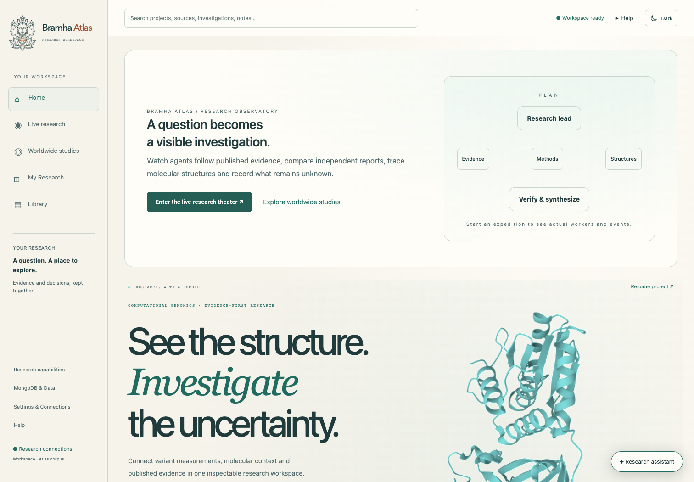
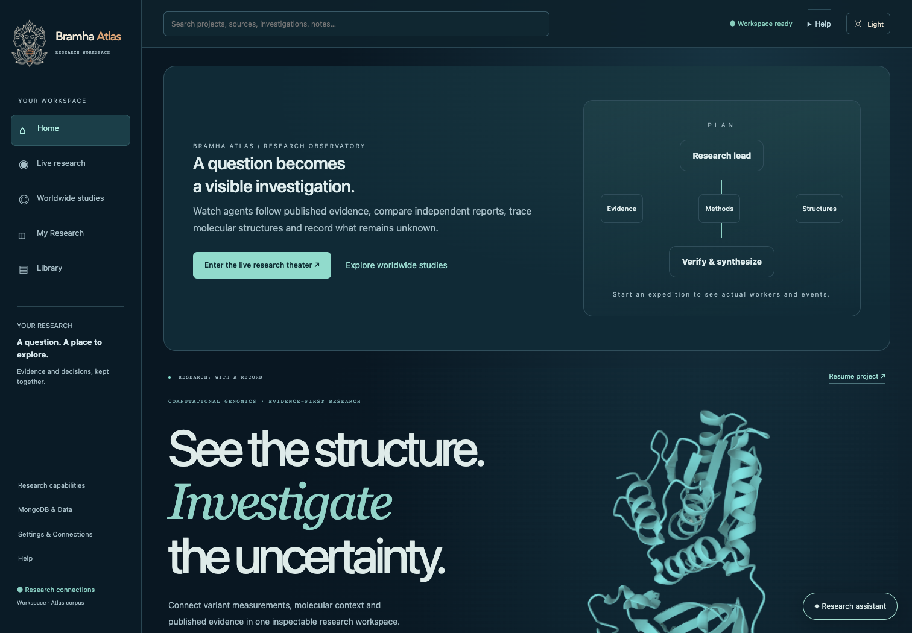
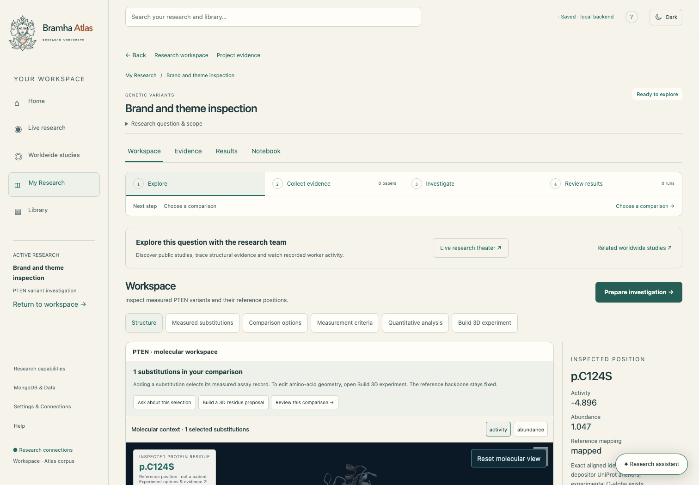
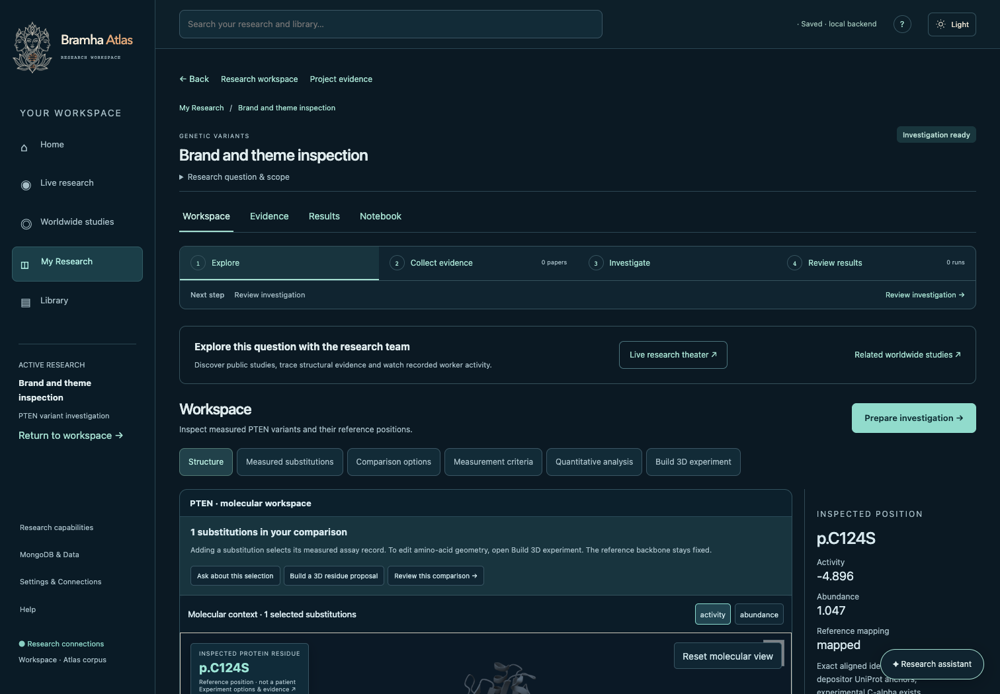
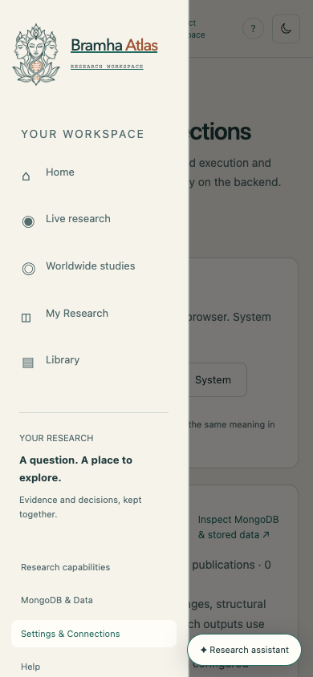
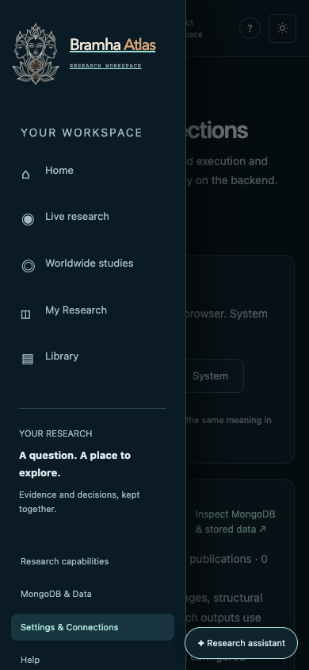

# Bramha Atlas — logo and color themes

Implemented October 24, 2026.

## Preview

Open the running app at http://localhost:8500. The sun/moon button in the top bar switches themes. **Settings & Connections → Appearance** provides Light, Dark and System options.

[Open the standalone brand board](../artifacts/brand-theme/brand-board.html).

| Light | Dark |
| --- | --- |
|  |  |
|  |  |
|  |  |

## Identity and placement

The user's new three-face, crown, DNA and lotus illustration supplies the emblem. A transparent emblem is paired with native, selectable **Bramha Atlas** typography. Copper differentiates “Atlas.”

- **Workspace sidebar:** complete emblem, including DNA and lotus, beside the wordmark.
- **Compact component:** crown and three-face crop beside the wordmark.
- **Footer:** small face-only mark.
- **Browser tab:** face-only mark on an ivory tile for readability against browser chrome.
- **Reusable exports:** full lockup and face-only symbols for both light and dark backgrounds.

The dark emblem uses an SVG color matrix on the same production PNG. It preserves the alpha channel and exact contours; it does not use a separately redrawn illustration. A generated dark recolor was rejected because it introduced noise in transparent areas.

## Palette

| Role | Light | Dark |
| --- | --- | --- |
| Page | Warm ivory `#f6f3eb` | Midnight teal `#0b1923` |
| Surface | Paper `#fffdf8` | Deep teal `#102430` |
| Main text / brand | Deep teal `#193b3b` | Pale ivory `#f2e9d7` |
| Interactive accent | Forest teal `#226b60` | Sea glass `#a5dfd0` |
| Wordmark accent | Copper `#9e5837` | Warm copper `#dda476` |

Semantic color tokens cover the product shell, homepage, research setup, library, paper reader, review sheet, results, and embedded scientific components. Existing dark colors remain declaration fallbacks. Scientific measurement ramps, mutation change colors and atom colors keep their data meaning. The molecular inspection canvas retains its dark backdrop in both themes.

## Behavior

1. On first visit, follow the device color scheme.
2. A top-bar toggle selects an explicit light or dark preference.
3. Save the preference under `bramha-atlas-theme` in browser local storage.
4. Apply the theme before React starts to avoid an opposite-theme first paint.
5. Preserve it across navigation and reloads; synchronize other open tabs.
6. With **System** selected, respond to device theme changes.
7. If browser storage is unavailable, selection still works for the current tab.

Theme switching does not execute research or call a model. The storage preference belongs to this browser, independently of project data.

## Assets

All production assets are checked into the app's public directory and work without access to the image generation folder.

- [Transparent source emblem](../frontend/public/branding/bramha-emblem.png) — PNG, 1088 × 1445, generated from the supplied reference.
- [Full light lockup](../frontend/public/branding/bramha-lockup-light.svg).
- [Full dark lockup](../frontend/public/branding/bramha-lockup-dark.svg).
- [Light face-only symbol](../frontend/public/branding/bramha-face-light.svg).
- [Dark face-only symbol](../frontend/public/branding/bramha-face-dark.svg).
- [Browser icon](../frontend/public/branding/bramha-face-icon.svg).

The SVG exports embed the original PNG for portability. Their typography is native SVG text with system font fallbacks; the emblem is raster artwork inside an SVG composition, not a fully traced vector illustration.

## Implementation

- `frontend/src/components/BrandLogo.tsx`: full, compact and symbol variants, native wordmark, exact dark recolor.
- `frontend/src/components/brand-logo.css`: responsive lockup proportions and WebGL-independent navigation paint.
- `frontend/src/components/Theme.tsx`: preference, system listener, cross-tab synchronization, toggle and appearance settings.
- `frontend/src/theme.css`: shared light palette and theme controls.
- Existing workspace/scientific stylesheets: semantic palette fallbacks at their declaration sites, including lazy-loaded components.
- `frontend/index.html`: theme bootstrap before React and updated browser icon.

## Image preparation provenance

Used the **built-in imagegen tool**, not the CLI or an API script. The original generated PNG remains in Codex's generated-images folder; the production copy is stored above. The supplied raster reference was prepared as a transparent emblem rather than an editable vector tracing.

Final production prompt:

> Edit the user's most recent Bramha Atlas logo image into a production-ready transparent emblem asset. Preserve the EXACT distinctive three-face line drawing, elaborate pointed lotus crown, profiles, central serene face, intertwined DNA helix and bottom lotus leaves from the reference. Remove the entire cream background and remove ALL the text/wordmark. Output ONLY the complete original emblem, centered, tightly framed with a modest 4% transparent margin, tall portrait proportions. Very clean smooth crisp dark charcoal/deep teal linework (#193b3b), copper orange DNA crossbars (#b76c42), transparent spaces between all strokes, no cream or white fills anywhere, no bounding panel, no shadow, no new symbols, no simplification, no redesign. This must be the same illustration recognizable from the supplied reference, not a generic logo. High resolution alpha PNG. The result will be placed beside native typography in a scientific research application's light and dark themes.

Rejected recolor prompt, retained for reproducibility:

> Create the dark-mode color variant of this transparent Bramha Atlas emblem. This is a strict recoloring edit, no redesign. Preserve every contour, profile, crown, face, DNA helix, lotus leaf, placement, proportions, and transparent spaces EXACTLY. Change ALL dark teal linework to warm pale ivory (#f2e9d7), keeping the DNA crossbars warm copper orange (#dc9566). Keep true alpha transparency everywhere else, including inside faces and leaves. No background, no panel, no text, no glow, no shadow. Same complete centered emblem and composition as the edit target, high resolution transparent PNG.

## Verification

**Result:** 8 browser checks passed in the final run: 3 brand/theme checks and 5 existing molecular-homepage regression checks. The production build passed. Browser checks recorded no unexpected page errors or paid model execution; the fallback test deliberately disables WebGL.

Focused Playwright checks use isolated local storage on ports 8002/8502 with live model keys disabled. They verify system preference, explicit preference persistence, cross-tab synchronization, brand rendering, desktop/mobile layout, real PTEN viewer selection, unchanged assay gradient, and readable local document content. Screenshots are stored in `artifacts/brand-theme/`.

Production build: `cd frontend && npm run build`.

The existing Mol* dependency still produces a large-bundle advisory during the successful build.
