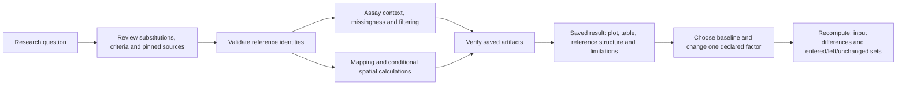
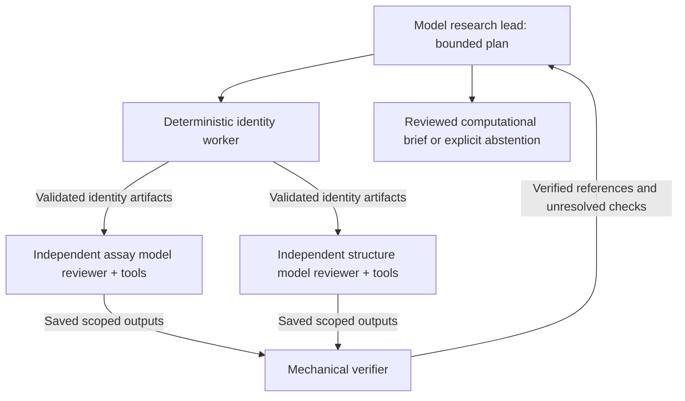

# Bramha Atlas: executable investigations and visual results

Implementation and reference checks, 25 October 2026. Implements [the supplied brief](bramha-atlas-experiment-analysis-and-visual-results-codex.md). See the separate [operation-by-operation execution audit](EXPERIMENT_EXECUTION_AUDIT.md).

## Open the delivered experience

The frontend runs at `http://localhost:8500`; the backend is separate on port 8000.

- [Visible world map and adjacent study results](http://localhost:8500/worldwide).
- [Public PTEN reference workspace](http://localhost:8500/research/project-c5786c930ae040d693910c78a4a548eb/workspace?view=analysis&analysis_run=research-6be0a905e61a40eda99c4bcce147da1d&selected_id=PTEN%3Ap.Y16T).
- [Saved successful autonomous team run](http://localhost:8500/research/project-c5786c930ae040d693910c78a4a548eb/investigations/research-00f7ec8b7690404db6f033a509507c8c).
- [Compare supplied structures](http://localhost:8500/research/project-c5786c930ae040d693910c78a4a548eb/workspace?view=experiments). Two public reference copies and their saved comparison are available here.

The homepage and top-level navigation are preserved. The new work stays within existing research, results and observatory routes.

## Walk through the scientific workflow



1. Open a PTEN project, then **Workspace → Quantitative analysis**.
2. Inspect the proposed computation plan and the derivation of the default boundaries.
3. Keep or change the selected substitutions. Review the native assay criteria and confirm the inputs.
4. Choose **Run & save baseline analysis**. Actual Python/SQL computations create a saved investigation without an LLM request.
5. Select an executed operation. Its purpose, method, input versions, result, meaning, limitations and exports appear together. The 3D reference sits beside the result on wide screens.
6. Select a plot point or table row to inspect that substitution in the experimental reference. Missing measurements and unavailable coordinates remain explicit.
7. Choose **Use this result as baseline**, change one criterion and confirm again. The follow-up is a separate saved run.
8. Inspect the exact before/after inputs and candidate lists. Export measurements CSV, analysis JSON or the selected SVG plot.
9. Reopen or reload the saved result: the selected operation and reference position remain in its URL. Opening a result does not rerun a computation or call a model.

## Worked real-data example

Frozen dataset: `pten-transform-1.0-97b699d687c8`. The selected substitutions are C124S, R172H and Y16T. These are actual public measurements; the case is an exploratory descriptive comparison.

| Substitution | Activity: native yeast enrichment | Abundance: native VAMP-seq | Baseline selection |
|---|---:|---:|---|
| C124S | -4.895642908999999 | 1.04741806408857 | Included |
| R172H | -0.090125298 | Missing | Unavailable for the paired rule |
| Y16T | -0.281762937 | 0.878622335811746 | Excluded |

Baseline: activity ceiling **-1.11**, abundance boundary **0.6121866579147568**, preserved-abundance/reduced-activity scenario. The default derivation remains inspectable; these are not clinical cutoffs.

The follow-up changes only `criteria.activity_cutoff` from **-1.11 to 10**. The abundance criterion, selection, mapping policy and source versions stay fixed.

- Entered: **Y16T**.
- Left: **none**.
- Unchanged: **C124S**.
- R172H remains unresolved because its abundance observation is missing; it is not replaced with zero.

This demonstrates a reproducible analytical-rule difference. It does not demonstrate a new biological effect or establish the cause of a mutation's behavior. The experimental reference structure remains the reference; this mission does not generate a changed fold.

The baseline executes twelve operation results: identity, canonical sequence, both assay descriptions, comparability, coverage, filter, structure metadata, precomputed alignment audit, mapping, neighbors and pair distance. Spatial operations have explicit coordinate preconditions and recorded skips when those preconditions fail. There are **zero model requests** in the baseline and follow-up. [Exact reference report](../artifacts/experiment-analysis/real-reference-check.json).

## Autonomous agent work



These are actual internal A2A assignments and artifact transfers. They are not an external A2A protocol interoperability claim. The displayed network uses saved task identities, dependencies, statuses, provider usage and messages; it does not invent workers or animate a fictitious simulation.

New UI PTEN investigations opt in to autonomous teams. Each model reviewer has its own provider context and artifact scope. The scheduler waits on real task futures, respects dependencies and tool/request/time/cancel ceilings, and lets independent assay and structural work overlap. Required reviews cannot be bypassed by the lead's success declaration.

Live public-only reference run `research-00f7ec8b7690404db6f033a509507c8c` completed with limitations:

- Research lead and all four delegated workers completed.
- Independent assay and structural review intervals overlap in recorded timestamps.
- **5 model requests, 10 deterministic tool calls, 11 saved messages, 4 findings**.
- Actual successful provider: **OpenRouter / x-ai/grok-4.3**. This check does not claim successful Argon execution.
- Provider-reported cost: **USD 0.2214564** for this run; it is not a future cost estimate.

An earlier Google/Argon attempt switched to OpenRouter, then correctly abstained when numerical statements lacked exact artifact bindings. A subsequent live run exposed a typed-deserialization bug in cross-team verification; it was fixed and covered by a nonempty-finding regression. Both unsuccessful historical checks remain recorded. Numeric verification was preserved. [Successful live report](../artifacts/experiment-analysis/live-team-verified-report.json).

The quantitative mission's worker cards are explicitly labelled **Python scientific tools; no model**. Those deterministic task lanes are distinct from model-backed independent reviewers.

## Feature matrix

| Capability | What actually executes | Delivery status |
|---|---|---|
| Identity and provenance | Pinned-reference comparison, version and scoped artifact checks | Implemented; mismatch and invalid-binding regressions |
| Assay comparison | Structured endpoint/system/scale/direction comparison | Implemented; separate native scales |
| Missingness and filtering | Actual selected measurements, null handling and declared rules | Implemented; real baseline/follow-up and browser checked |
| Sequence/structure mapping | Read audited reference-to-construct correspondence | Implemented; explicitly precomputed audit, not freshly recomputed sequence alignment |
| Spatial inspection | Accepted C-alpha Euclidean distances and radius neighbors | Implemented; explicit coordinate preconditions |
| Baseline differences | Same-project/version validation, exact changed inputs and set differences | Implemented; one factor initially, API explicit opt-in for multiple factors |
| Visual results | Linked scatterplot, sequence strip, exact/missing-value tables, mapping, source and verification adapters | Implemented; values come from artifacts |
| Hypotheses and paper evidence | Existing bounded source reviews, quoted passages and versioned hypothesis actions | Preserved; only executed branches have outputs |
| Autonomous independent teams | Separate contexts, scoped messages, dependency scheduler and verification | Implemented; offline concurrency and live public-data checks |
| World research | Actual country outlines, affiliation shading, nearby selected-region results | Implemented; real Atlas corpus checked in light/dark/mobile |
| Level A: annotate substitution | Reference/alternative identity, measurements, mapped reference position | Implemented; mutant structure not computed |
| Level B: supplied structures | Validated PDB/mmCIF import, correspondence checks, Kabsch alignment, RMSD/displacements and superposition | Implemented; real files and browser checked |
| Level C: generate mutant fold | No rotamer-search/relaxation/validated-fold engine integrated | Disabled with the exact blocker; ideal CCD template exercise remains separately labelled |
| Inferential statistics / new ML training | No suitable experimental-design/training workflow declared | Unavailable in this mission; no fabricated p-values, energies or predictive scores |

## Supplied-model reference check

Two copies of the pinned experimental 1D5R structure were imported with explicit provenance stating that they are copies, not independent experiments. The same author residue IDs and insertion codes define accepted C-alpha correspondences, with sequence identity checks.

The saved fit uses **307 identity-matched C-alpha anchors**, observed-chain correspondence coverage **1.0**, and RMSD **1.892479828503678e-14 Å**. This near-zero value is numerical tolerance, not evidence of mutation recovery. A separate test rotates and translates the real structure and verifies that rigid displacement is removed by the fit. Incompatible sequence identity, absent chains, invalid files and cross-project access are rejected.

Original coordinates remain immutable. The rigid transform and aligned display copy are saved separately. Per-residue displacement and unmatched observed-residue masks are available; unobserved experimental regions are not interpolated. [Exact supplied-model report](../artifacts/experiment-analysis/real-supplied-model-check.json).

## Persistence and execution modes

The additions extend the existing `ResearchStore` artifacts/events with typed `analysis_results` and version-checked `agent_messages`. They do not add a disconnected database/event system. Core project investigations remain in the configured local store; the worldwide public corpus uses the configured MongoDB Atlas backend. Existing approved backups remain snapshots. Original supplied files and aligned copies use the existing project-scoped asset archive.

Historical runs retain their recorded content. New operation descriptions and messages are not retroactively invented. Playback reads saved events, makes no new model call and does not alter an outcome. Source text remains untrusted evidence. Keys remain server-side.

## Validation and artifacts

```sh
# From variant-atlas/backend
.venv/bin/python -m pytest -q

# From variant-atlas/frontend
npm run build
PW_FRONTEND_PORT=8503 PW_BACKEND_PORT=8003 \
  PLAYWRIGHT_CHROMIUM_EXECUTABLE_PATH='/path/to/chromium' \
  npx playwright test e2e/analysis-results.spec.ts e2e/final-experience.spec.ts \
  e2e/brand-theme.spec.ts e2e/observatory.spec.ts
```

The backend suite passes **143 tests**. The production build passes; Vite still reports the existing large molecular-library chunk advisory. Browser tests cover the full baseline → threshold change → follow-up → plot/3D selection → export → reload → saved result flow, real-file alignment, reading-position and follow-up persistence, failure feedback, themes/mobile, map selection and tools-only expedition replay. **All 11 targeted browser cases pass** across the completed regression checks; the final two analysis journeys were rerun after the last saved-view fix. Exact verification scope is recorded in [verification-summary.json](../artifacts/experiment-analysis/verification-summary.json).

Actual running-app screenshots:

- [Map and selected studies, light](../artifacts/experiment-analysis/world-map-adjacent-results-light.png).
- [Map and selected studies, dark](../artifacts/experiment-analysis/world-map-adjacent-results-dark.png).
- [Map and selected studies, mobile](../artifacts/experiment-analysis/world-map-mobile.png).
- [Actual completed multi-agent network](../artifacts/experiment-analysis/actual-autonomous-team-network.png).
- [Linked experimental reference and quantitative result](../artifacts/experiment-analysis/actual-linked-structure-results.png).
- [Supplied-model superposition](../artifacts/experiment-analysis/supplied-model-overlay.png).

Software tests check numerical and application contracts. They do not establish biological causation, clinical validity or independent reproduction of the published experiments.
