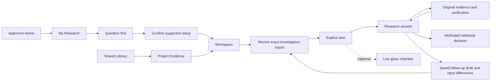

# Bramha Atlas — final experience implementation

## Before-change feature map

Recorded before implementation on 24 October 2026. The approved Home molecular scene, styling and logo are retained. Existing scientific stores and original run snapshots remain authoritative.

| Existing feature | Destination / adapter |
| --- | --- |
| Home molecular overview | `/`, unchanged composition; actions enter canonical research routes |
| Project catalogue and creation | `/research`, question-first `/research/new` |
| PTEN ResearchApp | `/research/:projectId/workspace`, reusing viewer, mapping, journal and context tools |
| Blood comparison | Same Workspace tab, using the existing comparative engine |
| Project sources | Evidence tab, backed by the canonical source catalogue |
| Shared Sources / PaperLibrary | `/library` and canonical source reader |
| ScenarioLab | Advanced comparison workspace view; no duplicate simulation engine |
| Exploration journal | Notebook tab, preserving original journal revisions |
| Investigation input wizard | Concise reviewed input sheet; same server-side gates |
| Investigation detail / glass chamber | Project-scoped run page, plain summary first; optional live chamber |
| Findings and all saved runs | Results tab; legacy unassigned work remains explicitly unassigned |
| Agent catalogue / executable tools | Secondary Research capabilities |
| Provider/storage status | Settings & Connections |
| Synthetic regression workspace | `/developer/demo`, clearly labelled |

## Data safety before changes

No scientific asset or historical run rewrite is planned. Existing catalogue migration remains idempotent and backs up metadata before adding retained source versions. New project fields, continuation drafts and paper-review records are additive.

For manual recovery, stop the backend and copy the complete configured `LOCAL_DATA_DIR` before upgrading. Defaults are under `variant-atlas/var`; inspect local configuration without sharing credentials. Preserve both `portfolio/metadata.json` and the scientific/paper stores, rather than restoring only catalogue links. To recover, stop the backend, retain the current directory as a separate backup, restore the full prior data copy and matching application version, then restart. Atlas adapter deployment remains unverified; use an account-level snapshot before a future Atlas migration.

The connected research workspace update is documented in [RESEARCH_WORKSPACE_V2.md](RESEARCH_WORKSPACE_V2.md), including biological objects, public evidence, structural proposals, multiple source reviewers and the separate cited assistant. That update supersedes the earlier single-review limits below.

## Implemented experience

The primary navigation is **Home · My Research · Library**. Research capabilities, Settings & Connections and Help are secondary. Active research uses exactly **Workspace · Evidence · Results · Notebook**. The approved Home molecular component retains its composition, typography, renderer, scroll behaviour and logo; its action destinations now enter the canonical flow. Shared navigation reflects the final information architecture.

### My Research and setup

- Lists actual projects with objective, area, last activity, readiness and Continue research. Recently opened items use backend-recorded visits; no productivity data is invented.
- Continue research restores the saved project tab, investigation or exploration subview. Workspace restores its existing scientific journal or explicitly saved paper-reading position.
- All investigations and Unassigned research are available inside My Research. Legacy records are not assigned automatically; compatible work can be linked explicitly from Results.
- Research starts with a question, examples and a registry-driven area picker. Known PTEN/blood terms offer a scoped deterministic setup. This is not a model interpretation or validation of the question.
- Broad questions remain visible and can start online evidence discovery and a scoped review. No arbitrary question is represented as a new scientific engine.
- Ten areas come from `backend/app/research_areas.py`. PTEN supports Genetic variants and Protein structure. Blood-group biology uses the existing comparative workflow. Cancer biology, Immunity, Drug mechanisms, Gene regulation, Neuroscience, Comparative biology and Study reproduction offer bounded paper review with their limitations visible.

### Workspace and evidence handoffs

- PTEN reuses the audited viewer, measurements, mappings, comparison proposals, selection/undo and exploration journal. Its structure occupies the main view, the substitution picker is a compact tray, and the context assistant expands within the right inspector. Mobile stacks the same functions without a floating full-screen assistant.
- Context assistance receives the actual project objective, active question, selection, criteria, pinned source metadata and applicable run identity. Prior investigations are scoped to the active project. Metadata inspection does not silently read paper text or invoke a model. Explicit prioritization remains optional.
- Blood projects retain deterministic scenario interpretation, independent ABO/RhD factors, saved comparisons and the same bounded comparative engine.
- Evidence-led projects show title-matched biological context, public reference search and a document reader for saved papers. Reading position and selected passages can be explicitly saved to backend project state; unsaved reading position is labelled locally.
- Evidence shows linked sources only. Add evidence offers existing Library records or a supported upload. Uploading links context; explicit inclusion is separate. The handoff strip distinguishes links, eligible preparation and review before execution.
- PTEN paper coverage remains first six passages per included paper, up to three papers. Blood runtime evidence remains the fixed corpus. A linked or prepared paper does not silently enter either engine.

### Library and multilingual reading

- One canonical source record exposes provenance, retained versions, preparation, original-language extraction, linked research and citing investigations.
- Original, Translation and Side by side are layouts of the same source. Translation is an explicit request for at most three selected passages; reading supports up to twelve selected passages. No full-document translation is claimed.
- Saved translations retain passage identities, requested language, provider/model, source version and actual coverage. Failed/cancelled translation attempts retain zero accepted coverage and a safe error category. Original bytes and extraction remain unchanged.
- Reading checks exact original-language quotations. Translations are explicitly model output, never presented as original quotations. Alignment and quotation checks do not establish translation quality or scientific truth.
- Russian, Japanese and Chinese fixtures verify UTF-8 preservation and alignment. These are scripted tests, not live translation-quality verification.
- A selected passage can be saved as a source-linked notebook observation or handed to a paper investigation. Paper review uses the existing reader/provider with up to twelve reviewed passages and Focused/Comparative/Extended profiles of 120/300/600 seconds, actual source reviewers and persisted observable events. It is not an autonomous disease analysis engine.
- Paper review cancellation prevents later findings from being accepted. Jobs left active when the local process stops become interrupted on restart. Provider failures remain failures with no fixture fallback.

### Review, execution and results

- One review sheet replaces the five-page input wizard. It exposes the exact question, selected objects/scenarios/passages, eligible source versions and gaps. Criteria and execution limits remain discoverable under advanced settings.
- Confirmation is never restored from browser drafts. Invalid selection, capacity, source readiness, source version or provider availability blocks the start action. The backend retains its original scientific validations.
- Investigation inputs remain frozen. Results first show the research outcome and its original status, followed by evidence, uncertainty and attributed interpretation.
- Live work defaults to a plain summary of actual saved events. The glass chamber, 2D timeline, replay, cancellation and evidence/tool outputs remain available for the scientific engines.
- Paper reviews show actual retrieval, source-reviewer and quote-verifier tasks, coverage, request counts and recorded replay.
- Citations retain project context, requested source version and a safe return-to-investigation link. The original evidence route can still be opened directly and refreshed.
- Continue research creates a durable draft with parent run, previous/new question, reason, baseline inputs and baseline source links where recorded. Review shows input differences and actual evidence-link changes. Missing historical link metadata is labelled as unknown. Starting creates a separate child run; a local lock prevents a draft from starting twice concurrently.

## Final route map

| Canonical route | Responsibility |
| --- | --- |
| `/` | Approved molecular Home and existing research dashboard |
| `/research` | My Research, saved projects and recent context |
| `/research?view=history` | All saved investigations |
| `/research?view=unassigned` | Explicitly unassigned historical work |
| `/research/new` | Question-first setup and ten supported area entry points |
| `/research/:projectId/workspace` | Scientific or document workspace |
| `.../workspace?view=table` | PTEN measured substitutions |
| `.../workspace?view=alternatives` | Existing explicit comparison proposals |
| `.../workspace?view=criteria` | Existing assay criteria |
| `/research/:projectId/evidence` | Linked, pinned project evidence and explicit inclusion |
| `/research/:projectId/results` | Outcomes, saved follow-up drafts, explicit historical linking |
| `/research/:projectId/notebook` | Attributed notes and exploration history |
| `/research/:projectId/investigations/new` | Reviewed input sheet |
| `.../investigations/new?followup=...` | Saved continuation and input difference review |
| `/research/:projectId/investigations/:runId` | Canonical research answer, actual execution and verification |
| `/library` | Canonical catalogue and supported import |
| `/library/:sourceId` | Provenance, reader, versions and usage |
| `/capabilities` | Registry-driven areas, supported workflows and advanced capabilities |
| `/capabilities/agents`, `/capabilities/tools` | Available role specifications / executable tool catalogue |
| `/settings` | Actual configured/verified connection states |
| `/help` | Five-step task guide |
| `/unassigned/:runId` | Saved run without invented project context |

Legacy `/projects`, `/projects/new`, project overview/explore/source/finding/notebook/investigation routes, `/sources`, source details, `/investigations`, individual runs, `/methods/*` and earlier root query routes redirect with relevant query/state context. Old runs resolve their actual project before redirecting. Explicit developer routes remain `/developer/demo`, `/developer/pten`, `/developer/blood`, `/developer/agents`.

The frontend uses browser history; Vite supports development refresh. A future production static host needs the corresponding history fallback. No public hosting was introduced.

## Design and state contracts

`frontend/src/workspace/experience.css` defines scoped colour, type, spacing, surface, border, radius, elevation, focus and motion tokens. Non-home styling is scoped to `.pw-app.experience`. The real molecular viewer and chamber keep their existing rendering engines.

The shell reports saving only for actual persistence requests and marks failure without discarding the working input. Success is shown after acknowledgement. Browser-only investigation drafts have a separate explicit message. Paper-reading position has its own unsaved/saved indicator and explicit save action. The source reader never claims its unsubmitted selection was archived.

Existing journal revision/undo and project state revisions remain authoritative. New fields (`area`, last context, continuations and run-link lineage) are additive. Paper-review records use the existing research repository with workspace `paper-review`. No new database was added. Source IDs, scientific datasets and historical inputs are retained.

Free camera orientation is not newly persisted: selection/focus and existing supported scene state restore through the original journal. Browser-tab drafts do not imply offline or cross-device continuation. The saved follow-up itself is backend-persisted.

## Implemented, unverified and deferred

| State | Capability |
| --- | --- |
| Implemented | Final navigation/routes, question-first setup, registry-backed areas, four project tabs, existing scientific engines, concise review, canonical citations, attributed notes and saved continuation lineage |
| Implemented | Bounded original-language reading/translation, passage alignment, checked original quotes, coverage, failure records, scoped document investigations and cancellation |
| Verified with scripted fixtures | Russian/Japanese/Chinese preservation and alignment; run failure/cancellation; browser translation layout and supported input handoffs |
| Unverified live | Successful Argon generation and live translation quality. Prior catalogue access succeeded; generation checks returned rate-limit/timeout failures. Configuration is not execution proof. |
| Unverified live | Atlas persistence/hybrid retrieval and Google Live voice; this UX work does not change their deployment status |
| Deferred | Full-document translation batching, OCR, arbitrary uploaded-data scientific analysis, new disease engines, mutant folding/docking, authenticated multi-user access and public hosting |
| Scope limit | The seven broad areas above use paper review, not validated domain-specific analysis. No clinical, dosing or treatment prediction is provided. |

## Verification and screenshots

Final command results and screenshot links are recorded below after verification. Tests use isolated temporary storage and empty live provider keys. Scripted outputs are explicitly fixtures, not evidence of a new successful live scientific/model run.

### Completed checks

- **Backend:** `backend/.venv/bin/python -m pytest backend/tests -q` — **96 passed**. Includes migration idempotency, frozen records, explicit inclusion/unlinking, native scientific checks, UTF-8 fixtures, translation alignment/failure records, document cancellation/interruption, contextual project scope and continuation lineage.
- **Frontend:** `npm --prefix variant-atlas/frontend run build` — passed. Vite retains its large-chunk warning for the molecular/3D dependencies; no claim of a small molecular download is made.
- **Browser regressions:** the complete 40-case suite initially passed 38. One older test dragged a canvas below the viewport; it now scrolls the real canvas into view before dragging. Another still expected the old “Research projects” heading; it now asserts “My Research.” The final 14-case targeted run passed both corrected cases and all primary journeys/homepage cases. All 40 case identities have passing results across these runs; this is not a claim of a subsequent single 40/40 run.
- **Sizes:** desktop 1512×1050, laptop 1280×900 and mobile 390×844. Checked keyboard skip/navigation, selection, one inline context inspector, save failure/retry, citations/return, refresh, replay, reduced motion and WebGL fallback.
- **Homepage:** captured before/after screenshots. Logo, molecular stylesheet and reference-renderer source hashes are unchanged. Molecular component changes are navigation destinations only. Existing homepage workflow cards retain the approved two scientific starting points; broader paper-led entry points belong in the new research flow. Visual comparison confirms the approved composition and typography; GPU-rendered screenshots are not asserted to be pixel-identical.
- **Isolation:** browser tests use temporary storage on ports 8002/8502 with empty live keys. Existing local scientific data and original regression screenshots are retained. New evidence is saved separately in `artifacts/product-experience/`.

### Review images

- [Approved homepage before](../artifacts/product-experience/home-before.png) · [Homepage after](../artifacts/product-experience/home-after.png)
- [My Research](../artifacts/product-experience/research-desktop.png)
- [Question-first setup](../artifacts/product-experience/research-new-desktop.png) · [Mobile](../artifacts/product-experience/question-mobile.png)
- [Scientific workspace on laptop](../artifacts/product-experience/workspace-laptop.png) · [Mobile workspace](../artifacts/product-experience/workspace-mobile.png)
- [Inline residue inspector](../artifacts/product-experience/inspector-laptop.png)
- [Linked evidence](../artifacts/product-experience/evidence-desktop.png)
- [Library](../artifacts/product-experience/library-desktop.png) · [Mobile Library](../artifacts/product-experience/library-mobile.png)
- [Original/translation fixture reading](../artifacts/product-experience/reader-desktop.png)
- [Investigation review](../artifacts/product-experience/review-desktop.png)
- [Scripted comparative result](../artifacts/product-experience/result-desktop.png)
- [Saved follow-up input review](../artifacts/product-experience/followup-desktop.png)
- [Capability registry in the product](../artifacts/product-experience/capabilities-desktop.png)

Screenshots of reading/results use explicitly scripted fixtures in isolated storage. They verify layout and handoffs, not live model generation or a newly validated scientific finding. The My Research/Library/Home local smoke screenshots use existing local records.
