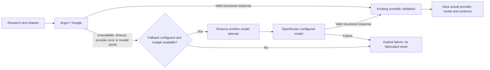

# Argon → OpenRouter fallback

Enabled in the local backend configuration on October 24, 2026.

## Configuration

Keep credentials in `backend/.env` only:

```dotenv
LLM_PROVIDER=google
LLM_FALLBACK_PROVIDER=openrouter
ARGON_MODEL=gemini-4-argon
OPENROUTER_MODEL=x-ai/grok-4.3
OPENROUTER_BASE_URL=https://openrouter.ai/api/v1
```

Both `GOOGLE_API_KEY` and `OPENROUTER_API_KEY` are already configured locally; neither is included in this document. OpenRouter fallback requires its key **and** model. `LLM_FALLBACK_PROVIDER=none` disables automatic failover. The example environment file documents the option without secrets.

## Request flow



The shared provider handles PTEN investigations, blood-group investigations, model-assisted scenario ranking, paper reading and paper translation. Explicit OpenRouter requests continue to use OpenRouter directly. Native Gemini Live audio is a separate protocol and is not routed through this structured-text fallback.

After an Argon failure, the same investigation provider instance uses OpenRouter for subsequent actions. A new investigation tries Argon again. Argon interaction polling is bounded by `LLM_TIMEOUT_SECONDS`; external cancellation does not trigger a fallback call. Existing investigation deadlines and request limits take precedence: failover cannot exceed them.

Paper reading and translation retain their original passage coverage, alignment and quotation checks. An invalid scientific citation is rejected by those checks; failover does not bypass scientific validation.

## Stored provenance

- Successful usage identifies the provider and actual returned model.
- Fallback metadata identifies the requested Argon model and the safe failure category.
- Investigations save failed attempts, reserve the fallback request before sending it, and emit a `model.fallback` event.
- The run's provider/model reflect the latest successful response. `requested_provider` and `requested_model` preserve the initial selection; usage records retain each provider involved.
- Paper readings and translations store fallback details with their result. Paper review runs include both attempts in their request count, including when both providers fail.
- Unreported costs remain unknown. Failed requests can still process remotely; cancellation of Google background work remains best effort.
- Exception categories are retained without copying raw provider exception messages into the fallback record.

**Settings & Connections** shows fallback readiness. **Results → investigation → Evidence → Execution details & export** shows the requested provider, actual provider, and attempt history. The Activity view includes investigation provider-switch events.

## Verification

- **109 backend tests passed**, including 13 fallback cases covering success, failures, malformed JSON, bounded timeout, cancellation, missing configuration, request limits, original-language reading/translation and failed-paper-review accounting.
- **Browser provenance test passed**: initial Argon selection, actual OpenRouter result, failed primary attempt and fallback explanation render in the investigation record.
- **Frontend production build passed.**
- **One live connection probe succeeded through fallback:** the Google/Argon interaction did not complete (`RuntimeError` category), then OpenRouter `x-ai/grok-4.3` returned a validated `inspect_state` action. This was a connection check, not a scientific investigation or evidence of successful Argon generation.
- The idle local backend was restarted and `/api/capabilities` confirms fallback is configured. No active investigation was interrupted.

Implementation: `backend/app/providers/actions.py`, orchestration/blood budget hooks, paper-review provenance, `/api/capabilities`, and the existing settings/result UI. Tests: `backend/tests/test_provider_fallback.py`, `frontend/e2e/provider-fallback.spec.ts`.
