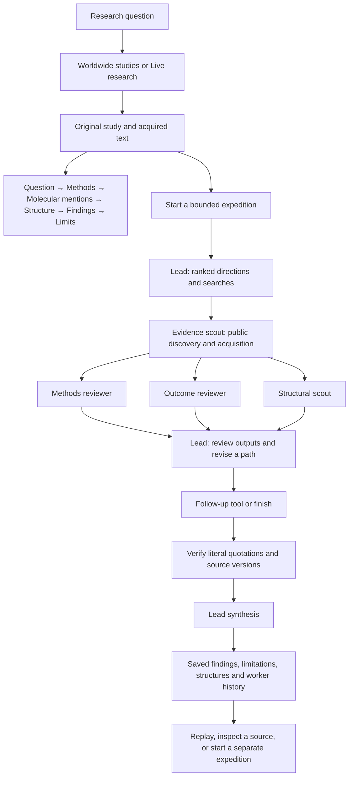

> Updated 25 October: the globe is replaced by a locally served country-outline map with adjacent selected-region results. The literal glass scene is replaced by a shared autonomous-team network showing saved dependencies and scoped handoffs. New quantitative investigations and supplied-model comparisons are documented in [EXPERIMENT_ANALYSIS_DELIVERY.md](EXPERIMENT_ANALYSIS_DELIVERY.md). Historical screenshots and earlier implementation notes below describe the preceding iteration.

# Bramha Atlas — Research Observatory

Implemented and verified on 25 October 2026. Frontend and backend remain separate.

## Start here

- **Live research:** http://localhost:8500/observatory
- **Worldwide studies:** http://localhost:8500/worldwide
- **Verified public expedition:** http://localhost:8500/observatory?run=expedition-2013dfb4cccf4b3da3a3850292e0aa59
- **PTEN source-to-structure record:** http://localhost:8500/worldwide/study-bab42a510430ae7ce52659ad

Existing projects remain available in My Research. Their Workspace links directly to the theater and related worldwide work. Project Results includes its saved public expeditions. A study’s **Use in my research** action links the archived source into a project with provenance; scientific inclusion remains an explicit decision.

## The connected workflow



### What appears at each step

| Step | Visible experience | Actual work |
|---|---|---|
| Discover | Publication cards, a geographic country map and adjacent region results | Europe PMC metadata discovery; lexical or multilingual vector retrieval |
| Read | Six connected study chapters | Original acquired passages, literal identifiers, access and source versions |
| Inspect geometry | Interactive molecular model and relationship label | Archived mmCIF coordinates; primary-citation metadata checked independently |
| Start | Question, source count, execution mode and time ceiling | Explicit saved expedition; bounded requests and tool work |
| Execute | Selectable 3D worker graph and inspector | Persisted assignments, tool outputs, provider attempts and public action summaries |
| Reconsider | Ranked paths and a recorded route-review decision | Lead chooses an additional passage inspection, structural check or finish |
| Review | Findings, original quotations, limitations and plots | Passage/version checks, concurrent worker intervals and source coverage counts |
| Replay | Timeline cursor and return-to-live action | Historical task timestamps/events; no tool or model is rerun |
| Ask | Separate public evidence guide | Retrieved public passages, checked citation identities, saved question and answer |

Methods, outcomes and structural work run concurrently after source acquisition. A cached structural lookup can finish immediately; plots show actual recorded overlap. Public action summaries are operational explanations, not hidden model reasoning.

## Verified Atlas contents

The [verification report](../artifacts/research-observatory/atlas-verification-report.json) records:

| Data | Count |
|---|---:|
| Public publication records | 480 |
| Studies with acquired open body text | 48 |
| Stored source passages, including retained earlier versions | 4,553 |
| Stored passage vectors | 4,533 |
| Literal molecular mention records | 2,356 |
| Acquired structural references | 21 |
| Study–structure relationships | 38 |
| Primary-publication structural relationships | 9 |
| Real PTEN measurement records from the pinned dataset | 7,657 |
| Explicitly synthetic planning templates | 240 |
| Approved local research snapshot files backed up and read-back verified | 223 |

Affiliation metadata covers 31 recognized countries. Affiliation matching describes institutions; it does not infer author nationality, participant location or study quality. Indexed abstracts and body text retain different coverage labels.

Synthetic templates are generated research questions. They do not contain fabricated published studies, laboratories, measurements or experimental outcomes, and are excluded from publication retrieval.

## Persistence

The application uses the supplied `variant_atlas` database. Secrets remain in the ignored backend `.env`.

| Collections | Stored records |
|---|---|
| `bramha_studies`, `bramha_passages` | Public identities, text versions, coverage, language, affiliations and vectors |
| `bramha_entities`, `bramha_structures`, `bramha_relations` | Literal sequence/variant mentions, actual coordinates and checked relationships |
| `bramha_measurements` | The real pinned PTEN assay snapshot |
| `bramha_scenarios` | Explicitly synthetic planning templates |
| `bramha_ingestion_jobs`, `bramha_metadata` | Acquisition checkpoints and verification metadata |
| `bramha_expeditions`, `bramha_tasks`, `bramha_events` | Research questions, plans, assignments, outputs, ordered events and budgets |
| `bramha_searches` | Explicit public evidence-guide questions and checked answers |
| `bramha_workspace_snapshots` | Exact approved local-file backups, checksums and timestamps |
| `bramha_assets.files`, `bramha_assets.chunks` | Content-addressed originals, extractions, coordinates and approved backup bytes through GridFS |

Existing projects, notes and original local investigations continue to use their existing configured project store. All 223 files in the approved manifest were backed up additively; local originals remain intact. This is a verified snapshot backup, not continuous bidirectional synchronization. Newly created project edits do not automatically become new Atlas backups. New public corpus and expedition records persist directly in Atlas.

## Models and scientific scope

- **Primary/fallback:** Argon is attempted first when configured; OpenRouter is the configured fallback. Provider attempts and failures remain visible per worker. The verified public expedition completed through OpenRouter after Argon was unavailable. It recorded eight tasks, ten model attempts, one acquired structure and four checked source-linked findings. This does not verify successful Argon access.
- **Embedding:** local pretrained `sentence-transformers/paraphrase-multilingual-MiniLM-L12-v2`, 384 dimensions. Atlas vector index `bramha_passages_multilingual_v1` was queryable. A Chinese-language query returned public studies through the actual Atlas vector path. No new embedding model was trained.
- **Computational work:** public retrieval, original-text parsing, identifier extraction, coordinate parsing, publication-link checks, passage/version verification and provider orchestration. The existing PTEN workflow separately supports measured assay analysis and structural geometry computations.
- **Limits:** this reconstructs published evidence and its structural context. It does not rerun a wet-lab study, infer a patient genotype, generate a validated mutant fold, establish binding or discover a cure. Source identity checks do not establish scientific truth. Missing methods or findings stay visible as missing coverage.
- **Budget:** focused, comparative and extended ceilings of 2, 5 and 10 minutes; 1–6 public studies; at most 12 model attempts, including fallback attempts. Work may finish earlier. Cancellation stops in-flight expedition work; deadlines preserve acquired evidence and mark unfinished tasks interrupted.

## Expand the corpus

Open Worldwide Studies → **Expand the public research corpus**. Supply up to 20 topic lines and 20–100 metadata records per topic. Each batch deduplicates publication identities, attempts up to 12 available open-text acquisitions and locally embeds up to 1,500 pending current-version passages. Progress and failures are saved. **Discover more online** provides a smaller topic-specific addition.

To reproduce the initial public batch from the backend directory:

```sh
.venv/bin/python ../scripts/bootstrap_observatory.py \
  --studies-per-topic 40 --full-texts 48 --embedding-limit 3000 \
  --reference-studies 8 \
  --output ../artifacts/research-observatory/ingestion-report.json
```

The bootstrap writes only public data, resumes its stored acquisition checkpoint and preserves existing documents. Reference-publication ingestion resolves actual PDB primary citations and checks their structural relationships. New unembedded passages can be indexed by a subsequent public batch; ordinary navigation never starts model interpretation.

Local/offline mode remains available through `CORPUS_BACKEND=local` and `CORPUS_EMBEDDINGS=disabled`. Atlas connection failures remain explicit; the corpus does not silently switch to another store.

## Screenshots and verification

Actual Atlas-backed screens:

- [Live expedition, dark](../artifacts/research-observatory/actual-expedition-dark.png)
- [Live expedition, light](../artifacts/research-observatory/actual-expedition-light.png)
- [Worldwide public corpus](../artifacts/research-observatory/actual-worldwide-dark.png)
- [Publication-linked molecular context](../artifacts/research-observatory/actual-study-dark.png)

Evidence files:

- [Atlas data and vector verification](../artifacts/research-observatory/atlas-verification-report.json)
- [Actual public agent expedition](../artifacts/research-observatory/live-public-smoke-report.json)
- [Approved backup verification](../artifacts/research-observatory/private-backup-report.json)
- [Primary-publication relationship verification](../artifacts/research-observatory/reference-citation-report.json)

Backend verification: 139 tests passed. Production frontend build passed; the pre-existing scientific rendering bundles still produce a size advisory. Isolated browser checks exercise source search, country filtering, original chapters, actual molecular rendering, an explicitly requested guide response, project linking, real tools-only execution, reload, recorded playback, mobile layout and navigation. Browser model responses use explicit fixtures; the separately recorded public expedition is a real live-provider execution.


## Study explanations and parallel follow-ups — 25 October 2026

On a worldwide study page, hover a passage or molecular identifier to preview its original context. Select evidence to retain it; **Explain & discuss** carries its passage IDs into the public evidence guide. The guide prioritizes those original passages and receives the actual available section coverage. Saved, source-checked interpretations become cached hover explanations after answering or reopening the study. Hovering itself never calls a model.

The shared Molstar viewer emits actual atom/residue picks, including author chain and residue numbering, atom name and coordinate model. The inspector preserves the publication-versus-related-reference label. A picked residue does not imply that the paper measured that residue or mutation.

**Suggest examinations** invokes a separate follow-up adviser through Argon with the configured OpenRouter fallback. Each proposal contains a research question, rationale, source passage IDs, missing evidence, expected outputs and limitations. The server checks citation identity and numerical literals against the supplied source text before saving. This is provenance checking, not scientific validation of the interpretation.

**Start parallel investigation** freezes the supporting public passages, links them to the chosen existing project or creates a new paper-led project, and starts an independent expedition. It does not interrupt an existing investigation or silently include the paper in another analysis method. Focused, comparative and extended ceilings are 120/300/600 seconds and 1/3/6 public studies. Focused branches return verified specialist reports directly, reserving adaptive replanning and narrative synthesis for longer runs. All expeditions checkpoint checked findings before optional synthesis so a deadline retains useful results. Each branch exposes recorded worker activity, actual tool operations and links to the team, results and project. Duplicate submissions with the same request ID reuse the branch; changing the source version requires generating fresh proposals. The expedition retains the original proposal, study, version and passage references.

Accepted public answers, proposals and branch records reside in `bramha_searches` when `CORPUS_BACKEND=atlas`; expedition workers and events use their existing corpus collections. The linked paper excerpt and project metadata follow the configured local project storage. The Data console can inspect these records. Existing private project content is not added to public-adviser or public-expedition model context.

Verification: `tests/test_study_actions.py` covers source checks, selected-passage retrieval, changed versions, duplicate requests, project linking and two independent real tools-only executions. `e2e/observatory.spec.ts` covers actual rendered residue hover, study selection, discussion context, proposals and completed worker output. Live public-only model and expedition audit metadata is saved under `artifacts/research-observatory/study-*-live-verification.json`.


## Interactive molecular evidence and colour annotations

Expedition results now share one selection state with the acquired molecular view. Literal mentions in saved observations receive category colours: genes/proteins (violet), variants (rose), cell/tissue context (blue), compounds (amber), processes (teal), and reported change words (orange). Selecting a coloured phrase or observation opens its explanation and original supporting passage. Context filters count observations, not measurements or independent experiments. Exact phrases can also receive a user-chosen view annotation; absent phrases are rejected. These optional labels are session-only and do not edit stored research.

The shared viewer reads chain identities, residue counts, entity descriptions and database aliases from the actual parsed coordinate file. Chain controls and exact identity matches apply Molstar overpaint layers to real atom selections, with camera focus and a reference/highlights toggle. Residue clicks use the picked author numbering and coordinate model. Selections do not re-download the coordinate asset. Mapping uses exact archived aliases or full entity descriptions; a literal variant mention alone does not establish a canonical residue alignment. Unmapped genes, cell/tissue terms and compounds retain their original text and a labelled concept illustration rather than receiving invented geometry or a claimed mutation effect.

Browser verification covers literal matching, unknown coordinate mapping, actual chain overpainting and residue picking, reference reset, custom phrase validation, responsive light/dark views and one asset download through repeated selections. Existing public-observatory and source-visual viewer regressions also pass. The running app's archived 1JSP reference is checked separately; its coordinate metadata identifies p53 and CREB-binding protein as distinct components. Public-only visual audit artifacts are under `artifacts/interactive-evidence/`.

## Original-language library and translation reader — 25 October 2026

Worldwide Studies now opens with original-language research cards. Choose a language to clear unrelated region, gene and question filters and show acquired native text. Publication language and acquired passage language are separate fields; an English indexed abstract is never presented as a Chinese, Japanese or Russian original. The language selector shows readable names rather than PubMed's three-letter codes. The acquisition panel imports a bounded public batch and records progress, missing native abstracts and source errors.

Actual public import `multilingual-701bac09d99d412e86acd65a9dd392d2` saved 20 native-abstract studies:

| Original language | Native-text studies saved to Library |
| --- | ---: |
| Chinese | 3 |
| Japanese | 2 |
| Russian | 3 |
| Spanish | 3 |
| Portuguese | 3 |
| French | 1 |
| German | 3 |
| Korean | 2 |

Chinese, Russian and other PubMed originals come from publisher-labelled `OtherAbstract` elements in the [official PubMed XML records](https://www.ncbi.nlm.nih.gov/books/NBK3828/?report=reader). Japanese originals come from native publisher abstract pages discovered through the [official J-STAGE API](https://www.jstage.jst.go.jp/static/files/ja/manual_api.pdf). The import explicitly records indexed records whose native abstracts are unavailable. Current acquisitions are publisher abstracts, not complete full papers or experimental reproductions. Every source retains its actual rights/access label and original publication link.

**Read original & translate** opens aligned original and model-translation columns. Choose the acquired source language, select up to three original passages and explicitly request a translation into a selectable target language. Layout changes, source-language changes and reopening a study never invoke a model. Saved translations, original quotations, source versions, actual provider/fallback and coverage remain visible. Previous unsuccessful attempts remain inspectable in collapsed history. Original passages can be sent to the existing discussion adviser and follow-up workflow. The Library link opens the imported UTF-8 original; its public-evidence banner returns to the bilingual study reader and saved translations.

There are **84 selectable target languages**. This is a request catalogue, not a claim that all 84 have been independently verified with Argon. Live Chinese→English, Japanese→English and Russian→English requests succeeded with exact source/passage alignment. Google `gemini-4-argon` was unavailable in these checks; the actual answering provider was the configured OpenRouter fallback, `x-ai/grok-4.3`. Translation checks require aligned passage IDs, retained original scientific identifiers and numeric preservation. The numeric comparison allows explicit calendar equivalents, such as April 2020 and 2020年4月, and numeric date zero-padding; it retains decimal, percentage and negative-value checks. These are mechanical checks, not verification of semantic translation accuracy. Model translations remain labelled for researcher review.

### Storage and retrieval

- `bramha_studies`: native title, publisher native abstracts, publication languages, acquired text languages, coverage, source version and Library identities.
- `bramha_passages`: original UTF-8 passages with language, original source URL and immutable study/version identity. Old versions remain retained.
- `bramha_entities`: exact acquired-text identifiers for each source version.
- `bramha_assets` GridFS: original public PubMed XML/J-STAGE HTML plus extracted original-text assets, addressed by checksum.
- `bramha_searches`: completed aligned translations and unsuccessful attempt records, tied to exact original source versions and actual provider usage.
- `bramha_ingestion_jobs`: bounded language imports, native-text/missing-native counts and embedding status.
- Configured local `papers/` and portfolio catalogue: content-addressed UTF-8 Library copies of the acquired public native abstracts. This import does not back up private local papers or projects.

The 20 imported public studies received **99 local multilingual passage embeddings**, each with 384 dimensions, using the existing pretrained `paraphrase-multilingual-MiniLM-L12-v2` model. Only the imported public studies were selected for this indexing. Vectors live in the Atlas passage collection; no new model was trained. An English BRCA/hereditary breast-and-ovarian-cancer query returned both Japanese native studies through the actual Atlas Vector Search index. A fresh import indexes its own acquired current passages when local multilingual embeddings are configured. Literal CJK substring search also works without whitespace segmentation.

### Routes and verification

- `GET /api/observatory/languages`: target-language catalogue and scope.
- `GET /api/observatory/status`: actual native coverage by language.
- `GET /api/observatory/studies?language=zh&native_only=true`: native-publication discovery.
- `POST /api/observatory/multilingual/import`: bounded public import, optional Library copies, configured local indexing.
- `GET /api/observatory/ingestion/{id}`: saved progress and per-language results.
- `POST /api/observatory/studies/{id}/translate`: explicit versioned, aligned translation.
- `GET /api/observatory/studies/{id}/translations`: saved attempts for the current source version.

Backend tests cover native XML and J-STAGE HTML parsing, canonical language codes, original/version preservation, real Library creation, idempotent imports, native search, scoped embedding generation and rejection of altered numbers, missing identifiers, invented passage IDs or stale versions. Isolated browser checks cover language cards, publication-versus-text coverage, an 84-option target selector, explicit translation calls, failure recovery, saved translations, Library navigation, mobile dark mode and the existing agent discussion/parallel-work path.

Public-only verification artifacts and screenshots are in [`artifacts/multilingual-research/`](../artifacts/multilingual-research/). `public-import.json` records acquired native IDs and missing abstracts; `native-indexing.json` records actual local embedding work; `cross-language-retrieval.json` records the actual Atlas Japanese retrieval; `live-browser-verification.json` confirms exact originals, saved translations, resolving Library links, no browser errors, no model writes during navigation and mobile layout. Real translation records retain actual fallback usage. Screenshots with `fixture` in the name use explicit offline examples; `*-live.png` show acquired public sources.
