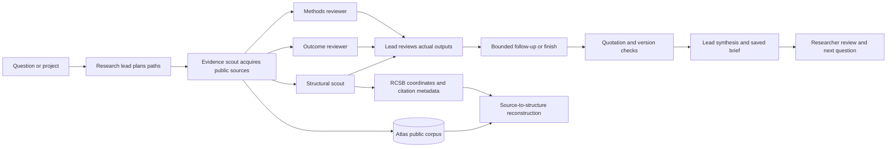

# Research Observatory: implementation plan

## Product objective

Make the research itself visible: a researcher asks a question, watches independent workers inspect published work, follows the evidence into molecular structures, and reviews what the evidence supports. Evidence collection remains connected to that view, rather than taking the researcher through disconnected setup pages.

## Connected experiences

1. **Worldwide studies** — search a persistent public corpus by question, gene, method, affiliation country and original language. Show exact acquisition coverage, institutions, provenance and related work. Synthetic planning templates are explicitly separate from publications.
2. **Study reconstruction** — inspect the reported question, methods, observations and limits as source-linked passages. Extract exact protein/DNA identifiers and sequence mentions. Acquire cited experimental coordinates when available; distinguish a paper-linked structure from a related reference. A paper without coordinates does not receive an invented fold.
3. **Live research theater** — start a bounded expedition from a question or project. A research lead plans paths; evidence, methods, outcomes and structural workers perform concurrent work; a verifier checks references; the lead assembles a reviewable result. The scene visualizes saved tasks, tool outputs and event transitions. No fabricated agent traffic or timer-controlled scientific results.
4. **Research record** — retain plans, events, task outputs, quotation checks, structure provenance, retrieval configuration and final limitations. Replay changes the inspected historical state, never backend execution.

## Storage and acquisition

Use the supplied `variant_atlas` Atlas database for the new corpus, assets, ingestion jobs and expedition records. Keep the existing local project store usable during migration. Back up existing research into additive Atlas snapshot collections; do not overwrite unrelated existing collections or delete local originals.

Dedicated collections: studies, original passages, extracted entities, structural references, evidence relationships, scenario templates, ingestion checkpoints, expeditions, worker tasks, ordered events, retrieval metadata, saved searches and content-addressed assets. Binary/full-text assets use GridFS with checksums. Each publication has a stable external identity, acquisition timestamps, coverage and access metadata.

Start with a bounded batch across cancer genetics, protein function, DNA repair, immunity and blood biology, plus openly licensed structural references. Ingestion is resumable and deduplicated; subsequent batches can expand the corpus. Free public metadata is distinguished from open full text. Access restrictions are retained, and failed extraction remains visible.

Use a local pretrained multilingual embedding model for passage vectors, record its exact name/dimension, and create an Atlas vector index. Query readiness is measured separately from index creation. Keep lexical retrieval explicit when semantic retrieval is unavailable. Default publication searches exclude synthetic templates.

## Verification

- Database ping, namespaced indexes, additive writes and round-trip reads.
- Duplicate ingestion, checkpoint resumption, missing coverage and source identities.
- Literal quotation/identifier extraction and paper-to-structure relationship labels.
- Stored vectors have the expected finite dimensions; a live query verifies the retrieval path.
- Task overlap, provider fallback, cancellation, interrupted-run recovery, durable events and final citation checks.
- Browser checks for global search, study reconstruction, live/replay state and keyboard/mobile behavior.
- Synthetic fixtures are labeled throughout and never become real published findings.

Official references: [Europe PMC services](https://europepmc.org/RestfulWebService), [RCSB Search API](https://search.rcsb.org/), [PyMongo index management](https://www.mongodb.com/docs/languages/python/pymongo-driver/current/indexes/), [FastEmbed models](https://qdrant.github.io/fastembed/examples/Supported_Models/).
