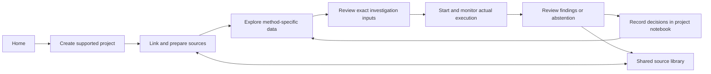

# Bramha Atlas: researcher workflow and route map

Implemented 24 October 2026. This document supersedes the earlier all-in-one UI walkthroughs; the scientific engine documents still describe their respective data and verification rules.

## Research journey

Blood-group comparative evidence review is a supported **project method**, alongside PTEN variant investigation. It has its own scientific inputs and engine, within the same project, source, investigation and review workflow.

The left navigation and project context remain stable. The selected page replaces the main working area: opening Sources, Notebook, criteria or a run no longer leaves a permanent molecular viewer above the requested content. The molecule belongs to Explore; the glass chamber belongs to a run's Live workflow tab.

## Routes and page responsibilities

| Route | Main task |
| --- | --- |
| `/` | Authentic PTEN overview → selected evidence, plus immediate resume/workspace actions, real projects, attention items and first-use guidance |
| `/projects` | Find a research project |
| `/projects/new?method=pten` or `blood` | Define title, objective and supported method; explicitly link reference package |
| `/projects/:projectId/overview` | Objective, supported scope, derived readiness and recent activity |
| `/projects/:projectId/sources` | Project-linked evidence, preparation, version review, optional paper inclusion and unlinking |
| `/projects/:projectId/explore` | Method-specific scientific workbench |
| `.../explore?view=table` | PTEN variant table |
| `.../explore?view=alternatives` | PTEN Explore alternatives, explicit change proposals and stale-context checks |
| `.../explore?view=criteria` | PTEN assay boundaries and capacity |
| `/projects/:projectId/investigations` | Project runs and explicit association of compatible unassigned historical work |
| `/projects/:projectId/investigations/new` | Five-step method-specific input review and explicit start |
| `/projects/:projectId/findings` | Completed, partial and abstained outcomes, linking to original run detail |
| `/projects/:projectId/notebook` | Researcher-authored notes, saved observations and durable exploration journal |
| `/sources` | One shared catalogue with lexical search and type/project/preparation/origin filters |
| `/sources/:sourceId` | Canonical provenance, preview, extraction, versions and linked work |
| `/sources/:sourceId?version=...&project=...` | Retained source version with return path to project |
| `/investigations` | All runs, grouped by project or explicitly Unassigned |
| `/investigations/:runId` | Canonical Summary, Live workflow, Evidence & checks, Activity |
| `/methods`, `/methods/agents`, `/methods/tools` | Supported workflows, available role specifications and executable capabilities |
| `/settings` | Backend-only provider, storage, retrieval and voice readiness; no credentials returned |

React Router supplies browser history and stable deep links. Vite's development fallback serves refreshed routes. Production static hosting would need its own equivalent fallback; public deployment is outside this change.

## Feature migration

| Previous surface | Destination / preserved behaviour |
| --- | --- |
| ResearchApp all-in-one screen | Project Explore: molecule, table, criteria and alternatives are separate visible working areas |
| Standalone BloodApp | Shared blood project Explore and investigation form; same blood engine and verification gates |
| PaperLibrary and local duplicate source views | Shared Sources and canonical source detail, referencing the original PaperLibrary store |
| ScenarioLab | Explore alternatives; preserves reviewed change descriptions, stale context, undo and capacity |
| Exploration journal | Project Notebook; project-scoped active scene and journal history |
| Old saved research lists | Global/project Investigations, each opening the same run detail |
| Glass chamber and accessible event timeline | Investigation detail → Live workflow; replay stays inside that run |
| Review briefs and abstentions | Findings → canonical run Summary with source links, original status and researcher review notes |
| AgentCollection | Research Methods → Agent roles; available roles do not imply active workers |
| Tool catalogue / provider readiness | Research Methods / Settings & Connections |
| Voice and contextual text commands | Relevant PTEN Explore workbench; exact scientific context retained |
| Synthetic regression workspace | Explicit `/developer/demo`, accessible from a disclosure under Research Methods |

Legacy `/?page=agents` redirects to `/methods/agents`; `/?page=blood` to blood project creation; `/?workspace=fixture` to `/developer/demo`; `/?run=...` to canonical run detail. Bare root opens Home. A legacy agent URL without project context opens the project picker. Original standalone layouts remain explicitly under `/developer/pten`, `/developer/blood`, `/developer/agents` for regression coverage. The old root records query redirects to Investigations. Developer PTEN records remain available explicitly for regression checks.

## Persistence and migration

Frontend and backend remain separate. `backend/app/portfolio.py` adds project/catalogue metadata over the existing scientific manifests, research snapshots and paper store. Original scientific bytes and frozen investigation requests are not rewritten.

- Local metadata: `LOCAL_DATA_DIR/portfolio/metadata.json` (default `var/portfolio/metadata.json`), schema version 1. File locking and atomic replacement protect metadata mutations.
- Metadata backups before catalogue migration: `portfolio/backups/*.json`. Initial creation has no previous file to back up. Repeated migration with no new source version is a no-op.
- Optional Atlas adapter: `portfolio_metadata` with revision compare-and-swap; `portfolio_metadata_backups` before migration. It has not been verified against live Atlas in this environment.
- Sources retain stable IDs and content/manifest-derived versions. Historical source manifests and paper passages remain in their original runs; catalogue metadata retains prior versions.
- Project links pin a source version. Linking an existing document does not copy its original bytes or include its text automatically. Unlinking removes only that project's link.
- Current method-required reference versions must be linked before a new investigation starts. Version changes require explicit review and repinning.
- Old investigations appear as **Unassigned**. Explicit compatible-project association is stored separately and leaves the original snapshot unchanged. New reviewed requests carry their actual project ID.
- Existing runs remain readable when current source assets are missing. Such sources show historical/failed preparation rather than implying the original is available.
- PTEN projects keep their own active exploration pointer and prior journey IDs. Rebinding is idempotent and a journey cannot belong to two projects. Scientific journal revision, undo and stale-context checks remain authoritative.
- Blood comparison saves are revision checked and their interpretation is re-derived server-side from the supplied scenarios.
- Notebook/review notes identify researcher authorship. Model findings and tool artifacts remain in the original run; saving a note does not upgrade its scientific status.
- Investigation drafts persist in `sessionStorage` per project for the current browser tab. Confirmations are never restored. Browser drafts are not a backend archive or offline capability.

## Source coverage and scientific boundaries

The catalogue uses existing adapters, not a universal parser. Papers accept supported PDF, UTF-8 text and Markdown uploads (8 MB limit). Original-language text is retained. Scanned PDFs require OCR; no OCR service or private university connector is implied.

Paper model reading is explicit and covers at most the first 12 extracted passages. PTEN runtime inclusion is separately explicit: at most three ready papers, at most six passages per paper. The blood workflow uses its inspected fixed corpus; uploaded papers can be linked as notebook context but are not silently treated as blood runtime evidence.

Global/catalogue search is lexical within the actual local workspace. Atlas hybrid retrieval, Google/Argon and Live voice are labelled by actual configuration and verification state. Ordinary page navigation does not start a model request; live prioritization in contextual research requires explicit opt-in.

PTEN remains a descriptive single-substitution assay/reference-geometry workflow, without mutant folding or clinical classification. Blood comparisons retain independent ABO/RhD factors and explicit unsupported conclusions. Mechanical verification is not scientific endorsement. The prior strict autonomous reference acceptance remains unpassed.

## Verification and review artifacts

`backend/tests/test_portfolio.py` covers idempotent migration/backups, frozen bytes, retained source versions, explicit project associations, shared document links/inclusion/unlink, readiness, revision conflicts, no provider calls on navigation, project-scoped scene pointers and historical access with missing reference assets.

`frontend/e2e/portfolio.spec.ts` exercises a first-time project journey, the actual PTEN viewer and saved selections, whole-area page replacement, central document import/link/inclusion/unlink, notebook notes, a reviewed blood form, canonical run tabs/citations, browser Back, refreshed drafts, stable deep links, grouped search and mobile navigation. Its completed blood run is an explicitly scripted browser fixture, not evidence of a new successful model execution. Browser regressions also retain the existing scientific/developer workflows.

Screenshots in `artifacts/`:

- [Home with existing local records](../artifacts/workflow-home-local.png)
- [Home in the isolated test workspace](../artifacts/workflow-home.png)
- [Project sources](../artifacts/workflow-project-sources.png)
- [Project exploration](../artifacts/workflow-project-explore.png)
- [Notebook](../artifacts/workflow-project-notebook.png)
- [Canonical investigation detail](../artifacts/workflow-investigation-detail.png)
- [Mobile source library](../artifacts/workflow-mobile-sources.png)

Screenshots use isolated test storage. Test-created projects are actual saved test records; they are not inserted into the user's local workspace.

## Deferred or unverified

No public hosting, authentication, multi-user access or private institutional integration was added. Atlas persistence/search, Google/Argon and Live voice require account verification. Full-corpus paper context, scanned-document OCR, general disease/species support and arbitrary uploaded-data scientific analysis are not implemented. Source extraction and lexical discovery do not establish scientific eligibility. Backend-persisted investigation drafts, cross-device resume of unfinished forms and an offline notebook remain future work.

The later [molecular overview](MOLECULAR_OVERVIEW.md) adds a single continuous presentation scene on Home only. Its versioned evidence handoff opens the existing project workflow; routine pages retain their ordinary layouts.
