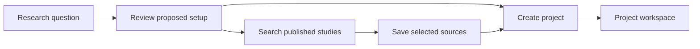
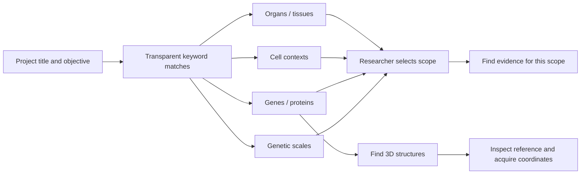
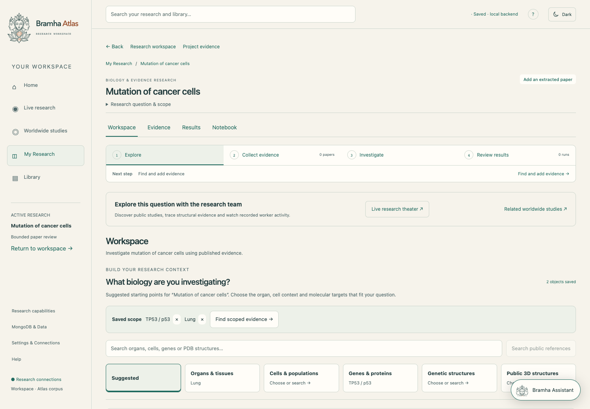
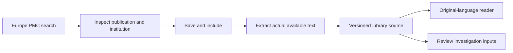
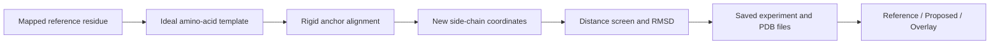
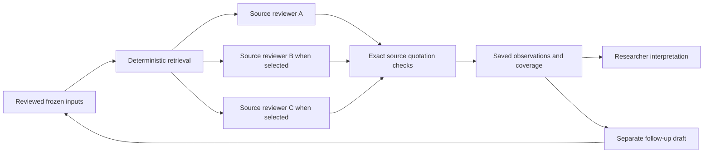
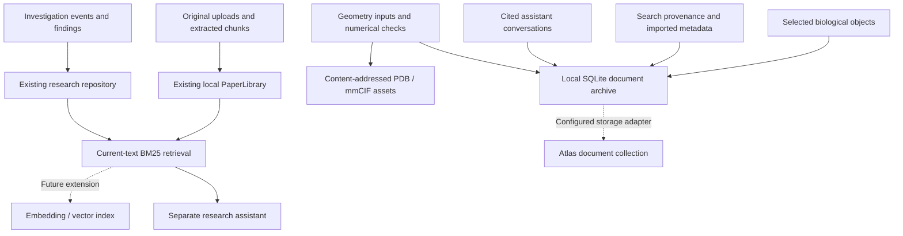
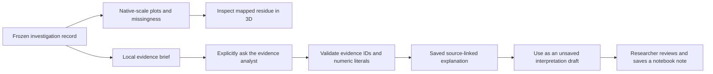

# Bramha Atlas: connected research workspace

This is the discussion and implementation map for the updated product. The primary route is **My Research → Workspace → Evidence → Investigation → Results → Notebook / follow-up**. All steps retain the same project context. The shared Library can support several projects.

## 1. State the research question

Open **My Research → Start research**, enter a question, review the proposed setup and create the project. For a broad question such as “mutation of cancer cells,” the app starts an evidence-led project. It does not silently choose PTEN, an organ or a patient genotype.

The setup can search Europe PMC for published studies. Saving a study before project creation includes that exact source when the project is created. Creating a project does not start a model investigation.

## 2. Choose the biological context

The previously empty evidence-led Workspace now contains a biological object pool. Transparent title matching suggests possible organs/tissues, cells, genes/proteins and genetic structures. Each suggestion explains its match and links to a reference. Suggestions are candidate directions, not biological conclusions.

Select **Add to workspace** to save an object to this project. Remove it using the selected object's × control. These selections persist after refresh, and the schematic highlights the chosen biological scales.

| Object | Local starting points | Search public references | What adding it means |
| --- | --- | --- | --- |
| Organ / tissue | Lung, brain, liver, heart and other contexts | EMBL-EBI OLS / UBERON | Choose the anatomical context for evidence discovery |
| Cell / population | Epithelial cells, T cells, cardiomyocytes and other contexts | EMBL-EBI OLS / Cell Ontology | Choose a cell context; no specimen is created |
| Gene / protein | PTEN, TP53, KRAS, INS, CFTR and other targets | UniProt human protein records | Save a referenced research target |
| Genetic scale | DNA, RNA, chromatin, protein structure | Inspect linked references | Organize the research question; no measured genome is invented |
| 3D structure | Search by gene/protein or structure terms | RCSB PDB | Acquire and archive actual public coordinates |

The organ/cell/gene diagram is explicitly schematic. Its dashed connections organize the question; they do not assert a measured interaction. Protein previews display acquired atomic coordinates.

## 3. Find and save readable evidence

Choose **Find evidence for this scope**, **Find related studies**, or the literature search field. Inspect a result's indexed abstract, authors, institution metadata and original record. **Save & include in this research** acquires open-access body text where available, otherwise the indexed abstract, and links the resulting readable source to this project.

The catalogue records which text was actually obtained. An abstract is labelled as an abstract. Affiliation metadata is supplied by the publication index and can be missing; the app does not claim access to private laboratory datasets.

The Evidence tab distinguishes a linked reference from an included readable study. Public metadata alone cannot satisfy a paper-review input. A missing study can also be searched and added directly from the investigation review screen, keeping the draft open.

## 4. Work with molecular comparisons

PTEN projects retain the existing measured-substitution workspace. Adding/removing a substitution changes the **comparison cohort** and its color annotations. It does not mutate the protein's coordinate file.

- The inspected residue has an explicit label and is not described as a patient.
- Scrolling zooms the camera without selecting an unrelated residue or invoking a model.
- Selecting a position uses a wider focus radius to retain surrounding structural context.
- The measurement legend sits below the molecular viewport.
- The viewer supports retry after load/graphics failures. Comparison state remains saved.
- New selections passed from the workspace take priority over an older review draft.

## 5. Build an explicit structural proposal

In a PTEN Workspace choose **Build 3D experiment**. Select an accepted mapped position, choose a replacement amino acid and press **Build 3D proposal**.

The backend performs real numerical work:

1. Read the pinned experimental reference coordinates and validate the residue mapping.
2. Acquire the selected amino acid's ideal template from the RCSB Chemical Component Dictionary.
3. Fit the template's N–CA–C backbone anchors by a rigid least-squares alignment with no mirror reflection.
4. Retain the reference backbone and all other residues; replace the selected side chain.
5. Compute anchor-fit RMSD and candidate-to-other-residue heavy-atom distances. Report contacts below 1.8 Å as a simple geometric screen.
6. Save the reference and proposed PDB files, inputs, source URL, dataset version, numerical results and limitations.

**Reference / Proposed / Overlay** modes show the actual coordinate files. Downloads are available. Exact activity/abundance measurements appear only when that exact substitution is present in the loaded assay data.

This produces an **unrelaxed geometry proposal**. It does not run folding prediction, molecular dynamics, docking, energy minimization, a newly trained model or a laboratory experiment. A close contact can motivate further validation; its presence or absence does not establish function or stability.

Possible DNA codons can be shown in an interactive 3D helix illustration. The flanking bases remain unknown. Codon possibilities are not inferred genomic edits because no transcript or genomic locus has been loaded.

Other PDB structures can be acquired into the local project archive. Displaying them does not simulate binding or create a validated protein complex.

## 6. Review and start an investigation

The review screen shows the question, source/version, selected passages or variants, and a plain explanation of any missing inputs. A first ready included paper and its first six passages are offered automatically for review; the researcher can change that selection. Confirmation is explicit and is never restored from browser storage.

| Size | Execution ceiling | Paper-review behavior |
| --- | --- | --- |
| Focused | 2 minutes | One source reviewer |
| Comparative | 5 minutes | Up to two source reviewers; optionally compare a second included study |
| Extended | 10 minutes | Up to three source reviewers; optionally compare three included studies |

Paper reviews retain a combined limit of 12 selected passages. Added studies contribute their first three passages. With one source and several passages, larger profiles can split those selected passages across reviewers. Actual task count is shown; the app does not invent workers to fill a diagram. Server request/tool/time limits still apply, and work can finish earlier.

The same time choices bound the existing PTEN/blood research engines, whose lead selects supported tools and delegates scoped checks. Argon remains the preferred configured brain with OpenRouter fallback; actual provider/model switches are recorded.

## 7. Inspect execution and results

The run page shows real queued/running/completed tasks, their role and execution engine, model attempts, deterministic tool calls, elapsed time and requested ceiling. Paper reviews perform passage retrieval, model source reading and exact quotation/identity checks. PTEN tools operate on loaded measurements and reference coordinates. Blood investigations retain the inspected comparative study corpus.

Results retain supported observations, unresolved questions, source links, actual coverage and uncertainty. A PTEN result also locates the selected measured substitutions on the experimental structure when the current dataset matches the run. It does not invent a new mutant fold. Structural proposals remain separately saved experiments.

Replay reads recorded events and can return to the latest state. It does not execute the investigation again. Cancellation and interrupted/failed execution retain their original status and inputs.

## 8. Ask the separate research assistant

The persistent **Research assistant** opens alongside product pages. It is separate from the investigation workers. Choose this project's evidence or the shared Library and previous research, then ask a question.

The backend ranks current source chunks and saved findings with local BM25 retrieval. The model can select server-generated literal quote spans by ID, so original punctuation and whitespace are retained rather than retyped. Selected research objects and the project objective provide query context. A model answer must cite a retrieved passage and provide an exact original quote for every accepted claim. Unknown citation IDs and unverifiable quotes are rejected. Conversation history is saved locally per project.

No paper passage match produces an honest “find and save evidence” path rather than an invented answer. Quotation consistency supports traceability; it does not prove the model's scientific interpretation.

## 9. Storage and future Atlas integration

Local archive: configured `LOCAL_DATA_DIR/research-hub.sqlite3`, with closed connections and WAL concurrency checks. Structural assets: `LOCAL_DATA_DIR/structure-lab-assets/`. Existing original papers, portfolio links and frozen scientific run repositories remain authoritative.

The archive uses the existing Atlas database handle when Atlas storage is configured. **Atlas deployment and vector retrieval are not verified or implemented as a new default in this update.** Current retrieval is lexical BM25; it is not advertised as a trained embedding model. Back up the full configured local data directory, including SQLite/WAL and assets, with the backend stopped before a future migration.

## Verification and practical limits

- Frontend production build passes; scientific renderer bundles retain the existing large-chunk warning.
- Backend suite: **118 tests passed**, including discovery/import contracts, project scope persistence, exact-quote rejection, archive concurrency, geometry invariants and parallel reviewer coverage.
- **Seven browser checks passed**, covering saved scope across refresh, mobile/dark appearance, public search UI, evidence-to-review handoff, enabled Start, task/result display, cited guide UI and repeated molecular view mounting. External/model browser responses use explicit fixtures; they do not establish live scientific accuracy.
- Live API verification uses official Europe PMC, UniProt, OLS and RCSB endpoints. Reference, Proposed and Overlay rendering and the 3D codon illustration also passed a browser check using captured live-coordinate output. The bounded live-check record and generated coordinate files are in `artifacts/research-workflow-v2/`. The final live assistant check returned HTTP 200 using OpenRouter / x-ai/grok-4.3 after the Google attempt failed: four claims with checked original quotations, eight retrieved passages and one persisted conversation message. Earlier failed formatting and quotation attempts remain in the verification record. Inspect `live-verification.json` for actual coverage and provider outcomes.
- No new training, patient-level inference, private laboratory access or wet-lab outcome is claimed.

Official API references: [Europe PMC](https://europepmc.org/RestfulWebService), [UniProt](https://www.uniprot.org/help/api_queries), [OLS](https://www.ebi.ac.uk/ols4/ols3help), [RCSB searchable attributes](https://www.rcsb.org/docs/search-and-browse/advanced-search/attribute-details), [RCSB coordinate downloads](https://www.rcsb.org/docs/programmatic-access/file-download-services).

## Result evidence analyst and plots

The Research answer page now places **What the evidence shows** beside an inline **Evidence analyst**. A brief loads from the saved run without a model request: observations, cited sources, recorded checks, measurement availability, criterion matches and limitations. It reads frozen input variants or saved measurement artifacts, preserving missing values and original run status. Historical records without saved rows do not inherit today's workspace measurements.

For PTEN results, the activity-versus-abundance scatter plot shows the run's declared boundaries and reported ±1 standard errors where available. A second plot switches between activity and abundance on separate native scales. Selecting a point or bar focuses the mapped residue in the 3D reference. A substitution missing one assay value remains selectable in the available assay's plot and is excluded from the paired scatter. The direct-load molecular view now includes its own layout styles, a properly spaced legend and a focused reference neighborhood.

Paper results show covered/selected passage counts. Other evidence reviews show saved finding-category counts when available; these counts are not biological effect sizes.

The analyst uses the existing Argon/OpenRouter provider path only after an explicit question. Its context contains this run's recorded evidence. Accepted explanations select known evidence IDs; numeric literals are checked against the cited record. Interpretation is still scientifically unreviewed. Explanations are stored separately in the local document archive and do not rewrite the investigation. Changed run revisions do not reuse an earlier interpretation as current.

Backend coverage includes frozen-versus-current measurements, missingness, rejected invented numbers, saved explanations and unchanged original run bytes. Browser verification uses an explicit model fixture. A live test on an existing user investigation was rejected by automatic approval review because it would transmit potentially private research to an external provider; that test was not performed.

Result analyst validation: 122 backend tests passed. The result browser journey passed on desktop and mobile, including chart-to-3D selection, missing-value handling, cited explanation UI and unsaved interpretation drafts; the three connected workspace browser regressions also passed. The production build passed. [Desktop result preview](../artifacts/result-analyst/brief-and-plots-desktop.png).
